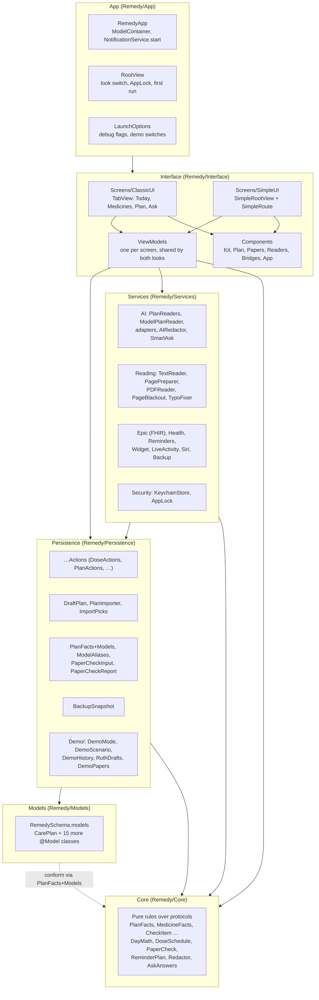
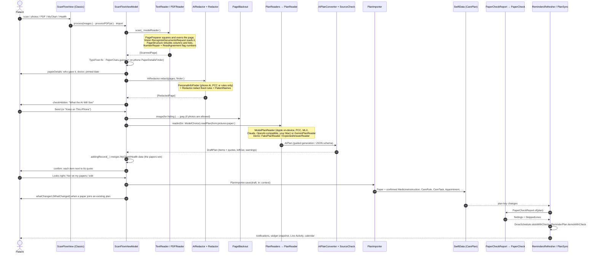
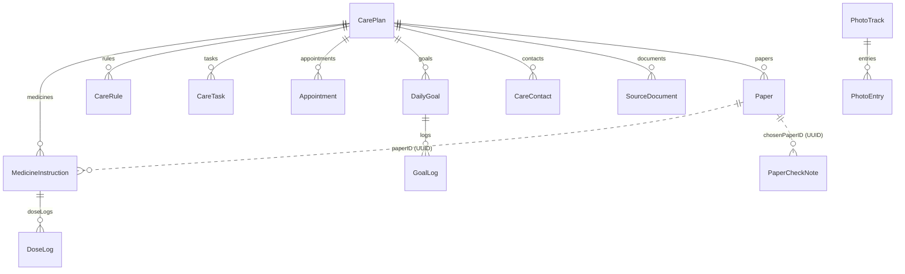

# Remedy architecture

Remedy is an iPhone app that turns a patient's surgery papers into a day-by-day plan: which medicines to stop and when, what to take after surgery and at what times, fasting rules, visits, to-dos, and who to call. It is built for iOS 27 with SwiftUI and SwiftData. The code compiles in Swift 5 language mode with default actor isolation set to `MainActor`. Pure rules in `Core` are marked `nonisolated` wherever they can be.

This document is for engineers: partner teams who evaluate the app, and contributors who change it. Every path below is relative to the repository root, and every type named here exists in the code.

All patient data in the repository, previews, tests and demo is fake.

---

## 1. Overview and design principles

### What the app does

1. The patient adds papers (camera scan, photos, PDF, MyChart, or Apple Health records).
2. The phone reads the words, hides names and ID numbers, and shows the patient the hidden version.
3. A reader the patient picked (on the phone, on their Mac, Apple Private Cloud Compute, or a cloud AI the patient set up with their own key) turns the hidden text into a **draft plan**. Each item in the draft carries the exact quote from the paper.
4. The patient confirms each item. Only confirmed items are saved.
5. Plain Swift rules then do everything else: compare papers, schedule doses, build reminders, the widget and the Live Activity, and answer questions.

### Principles the code enforces

| Principle | Where it is enforced |
|---|---|
| **Medical decisions are plain, tested rules in `Core`, never AI judgment.** AI reads pages into a draft, finds names to hide, picks which paper line answers a question, and may reword a red card's quotes. It never decides a dose, a day, or which paper wins. | `Remedy/Core/DoseSchedule.swift`, `PaperCheck.swift`, `NewerPaperRule.swift`, `ReminderPlan.swift`, `AskAnswers.swift`, `RestartRule.swift`, `FastingTimes.swift`, `WarningSigns.swift` |
| **The AI cannot add what the paper does not say.** An item whose quote is not on the page, or whose day the page does not state, goes to `DraftPlan.leftOut` with a reason. The patient can see these items, but they never enter the plan. | `Remedy/Services/AI/AIPlanConverter.swift`, `Remedy/Core/SourceCheck.swift`, `Remedy/Core/LeftOutItem.swift` |
| **Never hide a disagreement between papers.** Every pair of papers that disagree about a medicine becomes a red, blue or green finding. The app does not follow either line until a rule decides or the patient picks. | `Remedy/Core/PaperCheck.swift`, `Remedy/Persistence/PaperCheckReport.swift` |
| **Never silently fall back to a cloud AI.** A reader that fails or is unreachable shows a plain error and offers *Try on this iPhone*. It never switches readers on its own. | `ScanFlowViewModel.send()` in `Remedy/Interface/ViewModels/Scan/ScanFlowViewModel+AIChoice.swift`, `PlanReaders.reader(for:)` |
| **Privacy first.** Data stays on the device. Names and IDs are hidden before the planner sees a page. The patient sees exactly what will be sent and taps *Send*. Secrets are kept in the Keychain. | Sections 7 and 8 |
| **Two looks, one logic.** *Classic* (tabs, lists, sheets) and *Simple* (big tiles, one thing per page) draw the same view models. A rule or a word changes in one place. | `Remedy/Interface/ViewModels`, `Remedy/App/AppLook.swift` |

---

## 2. Layered architecture



### Layer rules

| Layer | Folder | Owns | May import |
|---|---|---|---|
| **Core** | `Remedy/Core` | Pure rules: dates, doses, paper check, reminders, redaction, Ask, wording | Foundation, plus `CoreGraphics` in `PageStructure.swift`. No SwiftUI, no SwiftData. Two known exceptions reach outside: `AppClock` reads `LaunchOptions`, and `PatientNames` reads `KeychainStore` and imports UIKit. |
| **Models** | `Remedy/Models` | SwiftData `@Model` classes and their raw-value enums (`Enums.swift`) | SwiftData |
| **Persistence** | `Remedy/Persistence` | Saving (`…Actions`), the draft plan, the importer, model-to-Core adapters, backup snapshot, demo data | Core, Models |
| **Services** | `Remedy/Services` | Everything outside the process or the app: AI models, Vision, Keychain, FHIR, HealthKit, UserNotifications, EventKit, WidgetKit, ActivityKit, App Intents | Core, Models, Persistence |
| **Interface** | `Remedy/Interface` | View models (strings, `Tone`s, spoken labels), shared SwiftUI components, and the two looks | All of the above |
| **App** | `Remedy/App` | `RemedyApp`, `RootView`, `LaunchOptions`, `AppLook` / `AppLookMode` | All of the above |

**How Core stays independent of SwiftData.** Core rules are generic over protocols declared in `Remedy/Core/PlanFacts.swift`: `PlanFacts`, `MedicineFacts`, `DoseLogFacts`, `RuleFacts`, `TaskFacts`, `VisitFacts` and `ContactFacts`. `Remedy/Persistence/PlanFacts+Models.swift` makes the SwiftData classes conform. Each line's `lineID` is its `persistentModelID`. `Remedy/Persistence/ModelAliases.swift` binds the generic types to the app's models:

```swift
typealias DayEvent = DayEventOf<CarePlan>
typealias AgendaItem = AgendaItemOf<CarePlan>
typealias Agenda = AgendaOf<CarePlan>
typealias ReminderItem = ReminderItemOf<PersistentIdentifier>
```

`Remedy/Persistence/DoseSchedule+Models.swift` adds `DoseSlot = DoseSlotOf<MedicineInstruction>` and `SkippedLines = SkippedLinesOf<PersistentIdentifier>`.

---

## 3. End-to-end flow: from paper to plan

The flow lives in `ScanFlowViewModel`, which is split across `Remedy/Interface/ViewModels/Scan/ScanFlowViewModel*.swift`. It runs as a state machine over `ScanStep` (`ScanFlowTypes.swift`):

`welcome → addPapers → pages → (importPick) → paperDetails → reading → checkHidden → confirm → finish → (whatChanged) → (setup)`

While `reading` runs, the screen shows progress through the `ReadingStage` values: `readingWords → removingPersonalInfo → modelReading → findingInstructions → done`.



### Step by step

| Stage | Types and files | What happens |
|---|---|---|
| **Capture** | `DocumentScanner`, `PhotoCamera`, `CalendarEventSheet` in `Remedy/Interface/Components/Bridges/`; `PaperIntake`, `PaperIntakeRunner` | VisionKit's document camera, the photo picker and the file importer hand `UIImage`s or a PDF URL to the view model. |
| **Text** | `Remedy/Services/Reading/TextReader.swift`, `PagePreparer.swift`, `PDFReader.swift`, `TypoFixer.swift`; `Remedy/Core/PageStructure.swift`, `DocumentText.swift`, `NumberRepair.swift`, `ReadAgreement.swift` | `PagePreparer` finds the page and corrects perspective and lighting. `TextReader` reads with Vision and rebuilds reading order from word positions. An optional second reader (`PageModelReader`: a downloaded MLX model or PCC, chosen by `ReadingChoice`) transcribes the photo. `ReadAgreement` shows any number the two readings disagree on. `TypoFixer` uses `UITextChecker` but never touches medicine names or numbers. |
| **Paper details** | `Remedy/Core/PaperClues.swift`, `DoctorKind.swift`, `HospitalFinder.swift`; `Remedy/Services/AI/PaperDetailsFinder.swift` | Fixed rules and the on-device model propose who gave the paper, the doctor and the printed date. The patient confirms. Fixed rules, never AI, decide whether a paper is from before or after surgery (`PaperClues.kind(in:usual:)`). |
| **Redaction** | `Remedy/Core/Redactor.swift`, `PatientNames.swift`, `MedicalWords.swift`; `Remedy/Services/AI/AIRedactor.swift`; `Remedy/Services/Reading/PageBlackout.swift` | See section 7. The output is a `RedactedPage` that remembers each hidden word, so a tap shows or hides every copy of it. |
| **Consent** | `CheckHiddenView` (`Remedy/Interface/Screens/ClassicUI/Views/Welcome/CheckHiddenView.swift`), `ScanFlowViewModel+AIChoice.swift` | The patient sees the hidden text and where it is going (`PrivacyPlace`: this phone, home network, Apple cloud, online). Nothing goes to the planner until the patient taps *Send*. *Keep on This iPhone* reads this paper with the on-device model. |
| **Reader choice** | `Remedy/Services/AI/ModelChoice.swift` (`ModelChoice`, `ReadingChoice`, `RedactionChoice`, `ModelSettings`, `ProviderModels`), `PlanReader.swift` (`PlanReader`, `PlanReaders`, `PlanReaderError`) | `PlanReaders.reader(for:)` is the one place a choice becomes a reader. Adding a provider takes one adapter file, one `ModelChoice` entry and one `case`. |
| **Readers** | `ModelPlanReader.swift` (any FoundationModels `LanguageModel`), `ClaudeAdapter.swift`, `OpenAICompatibleAdapter.swift`, `Local/LocalModels.swift`, `Local/MacConnector.swift`, `Gemini/GeminiPlanReader.swift`, `Gemini/GeminiClient.swift`, `Gemini/GeminiSchema.swift`, `AIPrompt.swift`, `PromptExamples.swift`, `AIPlan.swift` | Generation is greedy, so the same page gives the same answer. A model without guided generation, or without vision when photos are attached, throws `missingAbility` instead of quietly dropping a capability. Small on-device contexts read one piece of a page at a time (`askPieces`). |
| **Draft** | `Remedy/Persistence/DraftPlan.swift` (`DraftPlan`, `DraftMedicine`, `DraftRule`, `DraftTask`, `DraftAppointment`, `DraftGoal`, `DraftContact`, `DraftPage`), `AIPlanConverter.swift` | The converter keeps an item only if `SourceMatcher` finds its quote on the page. Anything else goes to `leftOut`. `ReadGaps` lists what the reader could not find (surgery date, doctor phone, …). |
| **Record merge** | `Remedy/Services/Epic/*`, `Remedy/Services/Health/HealthRecordsImporter.swift`, `Remedy/Persistence/ImportPicks.swift` | `DraftPlan.addingRecord(_:)` lets MyChart or Health data fill only empty fields and add medicines and visits the papers do not name. The papers always win. |
| **Confirm** | `ScanFlowViewModel+Confirm.swift`, `+Cards.swift`, `ConfirmView` | Each item is shown with its quote. *Not on my papers* removes it. `LastGivenParser` reads the hospital's last dose time strictly. If the time is unclear, it gives nothing. |
| **Save** | `Remedy/Persistence/PlanImporter.swift` | `PlanImporter.save(_:in:)` inserts one `Paper` record per set of papers and saves only items with `isConfirmed`. Each item keeps its `quote`, `quotePage`, `paper` kind (worked out from its own day) and `paperID`. A second paper joins the existing plan (`PlanActions.currentPlan(in:)`). Skipped pages become to-dos. |
| **Paper check** | `Remedy/Persistence/PaperCheckInput.swift`, `PaperCheckReport.swift`; `Remedy/Core/PaperCheck.swift`, `NewerPaperRule.swift`, `MedicineIdentity.swift` | Runs when needed from the saved plan, not at save time. The result is cached per plan and keyed by a fingerprint of its lines and notes. See section 4.4. |
| **Scheduling and output** | `Remedy/Core/DoseSchedule.swift`, `DayMath.swift`, `ReminderPlan.swift`, `Journey.swift`, `PlanAgenda.swift`; `Remedy/Interface/Components/App/RemindersRefresher.swift`, `Remedy/Persistence/PlanSync.swift` | Screens, notifications, the widget and the Live Activity read only the `…WithCheck` entry points, so every consumer follows the same paper line on each day. |

---

## 4. The parts in detail

### 4.1 Core: pure rules

**Owns:** every medical and scheduling decision, plus redaction rules and plain wording. Core has 65 files. It has no SwiftUI and no SwiftData. Most types are `nonisolated` enums with static functions.

| Area | Key types (file in `Remedy/Core/`) |
|---|---|
| Plan days and time | `DayMath`, `AppClock`, `DayPhraseParser`, `ExplicitDateParser`, `DateRoles`, `SurgeryDateFinder`, `FastingTimes`, `CheckInTime` |
| Doses | `DoseSchedule` (`SurgeryPhase`, `DayPeriod`, `DoseSlotState`, `DoseSlotOf`, `AsNeededStatus`), `LastGivenParser`, `RestartRule`, `MedicineOrder`, `MedicineText` |
| Paper check | `PaperCheck` (`CheckItem`, `CheckKind`, `CheckColor`, `CheckRule`, `Finding`, `DayRange`, `PaperCheckResult`), `NewerPaperRule`, `MedicineIdentity`, `MedicalWords`, `CheckWording`, `AskByReminder` |
| Plan views | `Journey`, `JourneyStops`, `PlanAgenda`, `PlanCalendar`, `DayChecklist`, `DayOrder`, `TonightHeadsUp`, `SurgeryMorningWords`, `SimpleHeadline`, `PlanFinished`, `WhatChanged` |
| Reminders | `ReminderPlan` (`ReminderKind`, `ReminderItemOf`), `RuleReminders` |
| Ask | `AskAnswers` (`AnswerKind`, `AskAnswer`), `AskFacts`, `InstructionTopics`, `WarningSigns`, `MedicineMatcher`, `MedicineSearch` |
| Reading and redaction | `Redactor` (`PersonalSpan`, `RedactedPiece`, `RedactedPage`), `PatientNames`, `PageStructure`, `PaperLayout`, `DocumentText`, `MarkdownText`, `NumberRepair`, `ReadAgreement`, `SourceCheck` (`SourceMatcher`), `LeftOutItem`, `ReadGaps`, `PaperClues`, `HospitalFinder`, `EmailFinder` |
| Editing and wording | `EditDrafts` (`MedicineDraft`, `AppointmentDraft`, `TaskDraft`), `PlanWording`, `SimpleWording`, `PlainText`, `PhoneFormat`, `PaperAbbreviations`, `AIChoiceLines`, `MacModelPick`, `PlaceFill` |

**How it is tested:** directly, through `DayMathTests`, `SmallRuleTests`, `PaperParserTests`, `PlainTextTests`, `NewerPaperRuleTests` and `PaperCheckTests` (built on plain `CheckItem`s from `RemedyTests/Fixtures.swift`). Indirectly, through the plan, action and screen suites, which run the rules on real models for every demo scenario.

### 4.2 Models: SwiftData

**Owns:** the stored shape of a plan. Every model is listed in `RemedySchema.models` (`Remedy/Models/RemedySchema.swift`). That list is used by `RemedyApp.makeContainer()`, by test containers (`Fixtures.context()`), by demo mode's wipe-and-load, and by the backup. See section 5.

### 4.3 Persistence

**Owns:** every write to the store, the draft-to-model import, the bridge from models to Core, backup snapshots, and demo data.

| File (`Remedy/Persistence/`) | Role |
|---|---|
| `DoseActions.swift` | `log`, `logAsNeeded`, `change`, `remove`, `undo`. A second answer for the same scheduled dose changes the first log. Every log returns a `DoseUndo`. A correction sets `changedByYou`. |
| `PlanActions.swift` | `currentPlan(in:)`, `setSurgeryDate`, `setDischargeDate`, `deletePlan`. Items store days as offsets, so moving the surgery date moves the whole plan. |
| `MedicineActions.swift`, `TaskActions.swift`, `AppointmentActions.swift`, `GoalActions.swift`, `ContactActions.swift`, `PaperActions.swift`, `ChatActions.swift` | Small typed writes, each ending in `ModelContext.saveNow()` (`ModelContextSave.swift`). |
| `DraftPlan.swift`, `PlanImporter.swift`, `ImportPicks.swift` | The draft, saving it, and the MyChart/Health pick list (`ImportRow`, `RecordImport`, `RecordPaper`). |
| `PlanFacts+Models.swift`, `ModelAliases.swift`, `DoseSchedule+Models.swift` | Model-to-Core adapters. |
| `PaperCheckInput.swift`, `PaperCheckReport.swift` | The bridge between the paper check and the other rules (4.4). |
| `PlanSync.swift` | After an edit, refreshes notifications, the widget snapshot, the Live Activity and (if turned on) the calendar. |
| `BackupSnapshot.swift` | Copies every model into Codable structs, linked by UUIDs, and restores them all or nothing. |
| `Demo/` | Section 10. |

**How it is tested:** `PlanStoreTests` (only confirmed items saved, second paper joins, backup JSON round trip, every demo plan saves) and `ActionTests` (dose log and undo, as-needed gaps and daily maximum, edits, contacts, to-dos, check-ins, moving surgery).

### 4.4 The paper check

This is the safety core of the app, so it is described separately.

1. `PaperCheckInput(plan:)` turns every medicine line from every paper into a `CheckItem`. Each item carries its paper's `PaperSource` (surgery team, another doctor, hospital record), its field, and its printed date.
2. `PaperCheck.run(_:notes:)` compares every pair of lines from **different** papers that name the same medicine (`MedicineIdentity.same`, which knows brand and generic names) and overlap in days. Two lines on the same paper are never compared. Group lines (for example "all blood thinners") are expanded to the medicines they cover.
3. Each pair becomes a `Finding` with a `CheckKind` (`differentAction`, `differentStopDay`, `differentDose`, `agree`, `notMentioned`), a `CheckColor` and the `CheckRule` that decided it:
   - **green**: the papers agree.
   - **blue**: a newer paper replaces an older one. `NewerPaperRule.decide` lets a newer paper win on its own only when it comes from the surgery team for the days it covers (`surgeryTeamCovers`), or when it was printed a month or more later (`muchLater`).
   - **red**: different doctors close together (`differentDoctors`), a missing printed date (`noPrintedDate`), or papers that beat each other in a circle (`circle`). Remedy does not pick. On a circle, no line is followed until the patient picks.
4. A `PaperCheckNote` (the office's answer and the paper the patient chose) resolves a red finding. Notes are passed to `run` as `findingKey → chosenPaperID`.
5. `PaperCheckResult.notFollowedDays` lists, for each line, the days it is not followed. `PaperCheckReport` turns that into `SkippedLines`.
6. **The one join point.** `PaperCheckReport.swift` defines the only entry points that consumers use:
   - `DoseSchedule.slotsWithCheck(onDay:plan:now:)`
   - `ReminderPlan.itemsWithCheck(for:now:checkedInDays:)`
   - `AskAnswers.answerWithCheck(_:plan:today:now:)`

   Today, Medicines, Plan, Simple Home, Family Share, the widget, the Live Activity and notifications all go through these (or pass `report.skipped` explicitly).
7. `AskByReminder` schedules a 9 AM "call the office" reminder for each open red finding. It nags daily once the ask-by day has passed.
8. `Services/AI/CheckExplainer.swift` (`PhoneCheckExplainer`, on-device only) may reword a red card's two quotes. The card, its color and its rule always come from `PaperCheck`.

**Tests:** `PaperRuleTests.swift` (rule 6 timing, missing dates, same team, saved notes, gaps, `notMentioned`, same-paper lines), `PlanBehaviorTests.conflictingPapersShowARedCard`, `DemoHistoryTests.papersShowEachPaperCheckColor` and `aPastDisagreementLeavesTodayButStaysOnThePapers`.

### 4.5 Services

| Folder (`Remedy/Services/`) | Owns | Key types |
|---|---|---|
| `AI/` | Reading a draft, hiding names, Ask, explanations | `PlanReader`, `PlanReaders`, `ModelPlanReader`, `ModelChoice`, `ModelSettings`, `AIPlan`, `AIPrompt`, `AIPlanConverter`, `AIRedactor` (`PersonalInfoFinder`, `PhonePersonalInfoFinder`, `ModelPersonalInfoFinder`, `RulesOnlyFinder`, `PersonalInfoFinders`), `PaperDetailsFinder`, `CheckExplainer`, `AppleAI` |
| `AI/Ask/` | Rules first, then the on-device model picks a paper line | `SmartAsk`, `AskPicker` |
| `AI/Local/` | Downloaded MLX models, a Mac on the home network (LM Studio, oMLX, Ollama), page transcription | `LocalModel`, `LocalModelStore`, `MacServer`, `MacConnection`, `PageModelReader` |
| `AI/Gemini/` | Gemini over REST with a JSON schema | `GeminiClient`, `GeminiPlanReader`, `GeminiSchema` |
| `Reading/` | Vision OCR and page images | `TextReader`, `ScannedPage`, `ScannedLine`, `PagePreparer`, `PDFReader`, `PageBlackout`, `TypoFixer` |
| `Epic/` | SMART on FHIR (MyChart) | `SMARTAuth`, `SMARTToken`, `PKCE`, `FHIRClient`, `FHIRMapper`, `FHIRTypes`, `EpicImporter`, `EpicConfig`, `ConnectionCheck`, `SampleFHIR` (demo) |
| `Health/` | Apple Health clinical records (medicines only) and steps | `HealthRecordsImporter`, `HealthService` |
| `Reminders/` | Local notifications, Calendar and Reminders | `NotificationService`, `CalendarService` |
| `Widget/` | The app-group snapshot the widgets read | `WidgetSnapshot`, `WidgetSnapshotMaker` |
| `LiveActivity/` | The busy-day Live Activity | `LiveActivityManager`, `ChecklistStore`, `RemedyActivity.swift` |
| `Siri/` | App Intents | `WhatToTakeIntent`, `TookMedicineIntent`, `RemedyShortcuts` |
| `Security/` | Secrets and the optional lock | `KeychainStore`, `AppLock`, `LockCheck` |
| `Backup/` | Encrypted backup files | `BackupFile.swift` |
| `Sharing/` | Family sheet PDF, mistake report | `FamilySheetPDF`, `FamilySheetPaginator`, `MistakeReport` |
| Other | `Permissions/PermissionStates`, `Places/AddressCompleter` (MapKit, no key), `Speech/Speaker`, `BuildKind` | |

**MyChart specifics.** `SMARTAuth.signIn(using:)` runs OAuth with PKCE through `WebAuthenticationSession`. It uses the scopes in `EpicConfig.scopes`: MedicationRequest, Appointment, DocumentReference and Binary, all read-only. `FHIRClient` reads medicine orders, visits, the surgery and up to 10 clinical notes. `FHIRMapper` turns an on-hold order into a stop and a PRN order into as-needed. Picked notes go through the same reading, hiding and checking as scanned pages.

**How Services are tested:** `RecordImportTests` (FHIR mapping from `SampleFHIR`, HTML notes, import picks, record merge), `PrivacyTests` (redaction), and `DemoHistoryTests.expectedAnswersReadEachSamplePaperAndNothingElse` (the demo reader). Services that need a device or network (Vision, FoundationModels, HealthKit, EventKit, UserNotifications) are not unit-tested.

### 4.6 Interface

**Owns:** what the patient sees and the words they read.

- **View models** (`Remedy/Interface/ViewModels/`, grouped by `Today`, `Medicines`, `Plan`, `Papers`, `Ask`, `CheckIn`, `Help`, `Share`, `Settings`, `Scan`, `Simple`). Most are value-type `struct`s rebuilt from `(plan, now)`, for example `TodayViewModel`, `PlanViewModel`, `MedicinesViewModel`, `AskViewModel` and `SettingsViewModel`. Multi-step flows are `@Observable` classes, for example `ScanFlowViewModel`. View models hold every string, pick a `Tone` (never a `Color`), and build VoiceOver labels.
- **Components** (`Remedy/Interface/Components/`):
  - `Kit` is the design system: `Theme.swift` with `Tone`, colors, `Spacing`, `Radius` and `Motion`, plus cards, lists and forms.
  - `Plan`, `Papers` and `Readers` hold shared feature pieces such as `PaperCheckCard`, `JourneyTimeline` and `AIChoiceView`.
  - `Bridges` wraps UIKit: `DocumentScanner`, `PhotoCamera` and `CalendarEventSheet`.
  - `App` holds `RemindersRefresher`, `LockScreenView`, `DemoPlanCard`, `LookSwitchedNote` and `PermissionPrimer`.
- **Classic look** (`Screens/ClassicUI`): a `TabView` with Today, Medicines, Plan and Ask, plus sheets. It also holds the first-run and add-papers flow (`Views/Welcome/ScanFlowView.swift`).
- **Simple look** (`Screens/SimpleUI`): `SimpleRootView` is a `NavigationStack` over `SimpleRoute` (`today`, `medicines`, `instructions`, `papers`, `ask`, `help`, `settings`). It is built from `SimpleScreen`, `FitOrScroll` and the tiles in `SimpleTiles.swift`.
- **Look selection** (`Remedy/App/RootView.swift`, `AppLook.swift`): `AppLookMode.automatic` picks Simple at accessibility text sizes and Classic otherwise. With no plan, `RootView` always shows `ScanFlowView`.

**How it is tested:** `ScreenTests` hosts each main Classic and Simple screen in a `UIWindow` for every `DemoScenario` and every `ShareChoice`. `ViewModelTests` builds view models at morning, afternoon and night. `SpeedTests` requires the Today and Simple Home view models to build in under 50 ms.

---

## 5. Data model

All models are `@Model final class`es in `Remedy/Models/`. `CarePlan` is the root of a plan. Its relationships use `deleteRule: .cascade`.



| Model | Parent | Key stored properties | Notes |
|---|---|---|---|
| `CarePlan` | root | `procedure`, `surgeryDate`, `dischargeDate`, `arrivalTime`, `surgeryStartTime`, `hospitalName`, `hospitalAddress`, `hospitalWhereToGo`, `sourceRaw`, `createdAt`, `checkInMinute`, `isSample` | Cascades to the eight child collections. |
| `MedicineInstruction` | `CarePlan` | `name`, `alsoKnownAs`, `isGroup`, `actionRaw`, `startDay`, `endDay`, `strength`, `amount`, `timesOfDay` (minutes after midnight), `minHoursBetween`, `maxPerDay`, `lastGivenAt`, `hospitalDoseAt`, `quote`, `quotePage`, `paperRaw`, `paperID`, `isConfirmed`, `restartNote` | Cascades to `doseLogs`. |
| `DoseLog` | `MedicineInstruction` | `scheduledFor`, `loggedAt`, `statusRaw`, `changedByYou` | |
| `CareRule` | `CarePlan` | `title`, `isAllowed`, `condition`, `startDay`, `endDay`, `quote`, `paperID` | |
| `CareTask` | `CarePlan` | `title`, `dueDay`, `isDone`, `doneAt`, `quote`, `paperID` | |
| `Appointment` | `CarePlan` | `title`, `date`, `doctor`, `place`, `address`, `phone`, `bring`, `questions`, `isInCalendar`, `calendarEventID`, `quote`, `paperID` | |
| `DailyGoal` / `GoalLog` | `CarePlan` / `DailyGoal` | `target`, `reps`, `sets`, `seconds`, `timesPerDay`, `startDay`, `endDay` / `loggedAt` | |
| `CareContact` | `CarePlan` | `name`, `phone`, `email`, `roleRaw` | |
| `SourceDocument` | `CarePlan` | `pageNumber`, `paperRaw`, `redactedText`, `scannedAt`, `paperID` | Stores only the **redacted** page text. |
| `Paper` | `CarePlan` | `id`, `kindRaw`, `sourceRaw`, `fieldRaw`, `doctorName`, `hospitalName`, `printedDate`, `addedAt` | One record per set of papers. Items point to it by `paperID`. |
| `PaperCheckNote` | none | `findingKey`, `chosenPaperID`, `officeSaid`, `whoSaid`, `date` | Resolves a red finding. |
| `ChatMessage` | none | `text`, `isFromPatient`, `quote`, `quoteSource`, `isWarning`, `callPhone`, `kindRaw` | Ask history. |
| `CheckIn` | none | `day`, `pain`, `signs`, `note`, `createdAt`, `editedAt` | One per plan day. |
| `PhotoTrack` / `PhotoEntry` | none / `PhotoTrack` | `name` / `takenAt`, `note`, `imageData` (`@Attribute(.externalStorage)`) | Wound photos. The app never analyses them. |

**Conventions**

- Days are offsets from surgery (`startDay`, `endDay`, `dueDay`, `CheckIn.day`). Day 0 is surgery day, and negative days are before it. `DayMath.date(forDay:from:)` and `dayOffset(of:from:)` convert both ways in `Calendar.current`.
- Enums are stored as raw strings (`actionRaw`, `paperRaw`, `statusRaw`, `roleRaw`, `kindRaw`, `sourceRaw`) with computed typed accessors. The enums are in `Remedy/Models/Enums.swift`.
- Items that came from a paper keep `quote`, `quotePage`, `paper` (before or after surgery) and `paperID`.

**Migration rule.** Every stored property is optional or has a default value. A new stored property must follow the same rule, so plans saved by an older version still open. Renames use `@Attribute(originalName:)`, never a plain rename. The rule is written at the top of `RemedySchema.swift`. The project relies on SwiftData's lightweight migration. There is no `VersionedSchema` or `SchemaMigrationPlan` yet.

---

## 6. Time, reminders and background work

### The clock

`Remedy/Core/AppClock.swift` is the only source of "now". Every view model, the reminder refresh and the widget snapshot call `AppClock.now()`. Outside demo mode it returns `Date()`. Demo mode changes it in two ways:

- **Day shift.** `LaunchOptions.demoDayShift`: the Settings demo steppers move "today" by whole days. The shift is clamped to ±365 by `LaunchOptions.clampedShift`. It only applies while `LaunchOptions.isDemoMode` is on.
- **Fixed time** (debug only). `-demoTime HH:mm` sets `LaunchOptions.demoMinute`. The clock starts at that minute on launch day and then runs forward in real time.

When the demo clock moves, `DemoModeView` or `DemoPlanCard` posts `.demoClockChanged`. `DemoClockRoot` in `RemedyApp.swift` bumps an `.id(stamp)`, so the whole view tree rebuilds and reads the new time.

### Notifications

- `Remedy/Core/ReminderPlan.swift` works out every notification: doses, stop days (8 AM), to-dos (9 AM), visits (the evening before and hours before), and the daily check-in. Each has a stable id. The total is capped at `ReminderPlan.maxCount = 60`, because iOS keeps only 64 pending.
- `NotificationService.refresh(plan:now:)` (`Remedy/Services/Reminders/NotificationService.swift`) removes all pending requests. It then adds `ReminderPlan.itemsWithCheck` (skipping days already checked in) and one `AskByReminder` for each open red finding.
- Dose notifications use the `DOSE` category with *I Took It* and *Snooze 10 Minutes* actions. `NotificationService.start(container:)` runs in `RemedyApp.init`, so an action can log a dose into the shared `ModelContainer` without opening the UI.

### What triggers a refresh

The app registers no background task. Freshness comes from three triggers:

1. `RemindersRefresher` (`.keepsRemindersUpToDate()` on the root) runs `.task(id: RemindersKey.make(for:))`. The key is a stable string built from the plan's dates, counts, medicine names and times, and check-in minute. When the key changes, it refreshes notifications, `WidgetSnapshotMaker.save` and `LiveActivityManager.sync`. It does the same on every `scenePhase` change except `.inactive`.
2. `PlanSync.refresh(_:)` does the same after edits, and syncs `CalendarService` when the patient turned the calendar on (`CalendarService.planOnKey`).
3. The widget extension (`RemedyWidget/RemedyWidget.swift`: `RemedyWidget`, `JourneyWidget`) reads `WidgetSnapshot` from the app group `group.com.dorronhoffman.Remedy`. Its own timeline provider rolls forward from that snapshot. `WidgetSnapshot.swift` and `RemedyActivity.swift` are compiled into both targets.

Because notifications are scheduled ahead, reminders keep firing when the app is closed. The 60-item window is refilled the next time the app comes to the foreground.

---

## 7. Security and privacy

### What leaves the phone, and when

| Data | Destination | Gate |
|---|---|---|
| Unredacted page text | On-device Apple model (`PaperDetailsFinder`, `PhonePersonalInfoFinder`) | Never leaves the phone. |
| Unredacted page photo or text | Apple Private Cloud Compute | Only if the patient set `ReadingChoice.privateCloud` (page transcription) or `RedactionChoice.privateCloud` (name finding) in Settings. |
| Redacted text (and a blacked-out JPEG unless *send text only*) | The planner the patient picked: on-device, PCC, their Mac, or a cloud API with their own key | The `checkHidden` consent screen. Nothing is sent before the patient taps *Send*. The screen states where the data goes (`PrivacyPlace`). |
| MyChart requests | The hospital's FHIR server | The patient signs in through `WebAuthenticationSession`. |

### Redaction pipeline

1. `PatientNames` holds the names the patient typed. They are saved in the Keychain under `patientNames`. Matching tolerates OCR typos ("smlth").
2. `Redactor.ruleFinds` hides values after personal labels (name, MRN, DOB, address, insurance, CSN, FIN, CEID, MyChart ID, …), bare IDs (`MRN NG-0047719`), and patient-header lines. It skips medicine words (`MedicalWords`) and never hides on a medicine line.
3. `AIRedactor.redact(_:finder:)` adds what a `PersonalInfoFinder` returns. The model classifies each span as patient, family or staff, so a doctor's name is not hidden. It then takes a second look at the top and bottom of each page. If the AI was not available, the page is marked rules-only, and the consent screen says so (`rulesOnlyNote`).
4. `PageBlackout.image(for:hiding:)` draws black boxes over the same words on the photo, using Vision's word boxes.
5. Hiding can be turned off in Settings (`ModelSettings.redactBeforePlanning`). If the planner sends data off the phone, the patient is warned (`needsRedactionWarning`, `sheetNotHiddenWarning`).

### Secrets

`Remedy/Services/Security/KeychainStore.swift` stores generic passwords with `kSecAttrAccessibleWhenUnlockedThisDeviceOnly` under the service `com.dorronhoffman.Remedy`. Accounts include:

- `patientNames`
- `ClaudeAdapter.keyName` (`claudeAPIKey`)
- `GeminiPlanReader.keyName`
- one key per OpenAI-compatible provider, from `OpenAICompatibleAdapter.keyName(for:)`, including the Mac connection

No API keys are compiled into the app. `EpicConfig.clientID` is a public OAuth client id, not a secret. The MyChart `SMARTToken` is held in memory for the length of one import and is not saved.

### What is stored on the device

- The SwiftData store holds the plan, redacted page text (`SourceDocument.redactedText`), dose logs, check-ins, chat and wound photos (external storage). It is not synced to CloudKit. Demo and scheme runs use an in-memory store (`ModelConfiguration(isStoredInMemoryOnly: LaunchOptions.isDemo)`).
- Preferences live in `UserDefaults`: reader choices, look, reminder switch, demo flags.
- Downloaded MLX models are excluded from iCloud backup (`isExcludedFromBackup` in `LocalModels.swift`).
- While demo mode is on, the real plan is kept as JSON at `Application Support/Remedy/DemoBackup.json`, written with `.completeFileProtection` (section 10).

### App lock

`AppLock` (`Remedy/Services/Security/AppLock.swift`) uses `LAContext.evaluatePolicy(.deviceOwnerAuthentication)` (Face ID or the passcode). It is off by default (`appLockOn`). `RootView` covers the app with `LockScreenView` when the app goes inactive or into the background.

### Backups

`BackupSnapshot.make(from:)` copies all 16 model types into Codable structs, linked by fresh UUIDs, including photo data. `BackupFile.seal(_:password:)` encrypts the JSON with AES-GCM (CryptoKit). The key is derived with PBKDF2-SHA256: 600,000 rounds and a random 16-byte salt. The file layout is magic `REMEDYBACKUP`, version, rounds, salt, then nonce + ciphertext + tag. On open, a file whose round count is outside 200,000 to 10,000,000 is rejected. Passwords must be at least 8 characters. Restore replaces the store all or nothing. The file is saved wherever the patient puts it in Files. There is no iCloud backup yet.

---

## 8. Testing

Tests use **Swift Testing** (`@Suite`, `@Test`, `#expect`, `#require`) in the `RemedyTests` target. Each test gets a fresh in-memory `ModelContainer` built from `RemedySchema.models` (`Fixtures.context()`). Suites that touch shared `UserDefaults` or the main thread are `.serialized`. Many tests are parameterized over `DemoScenario.allCases` or `ShareChoice.allCases`, so every demo plan is exercised end to end.

| File | Suites | Covers |
|---|---|---|
| `PaperRuleTests.swift` | `NewerPaperRuleTests`, `PaperCheckTests` | Rule 6 timing, missing or equal dates, red/blue/green, saved notes, gaps, `notMentioned`, same-paper lines, `DayRange` |
| `WordsAndDatesTests.swift` | `DayMathTests`, `PlainTextTests`, `SmallRuleTests`, `PaperParserTests` | Day math, clock and relative words, phones, HTML to text, check-in time, goal counts, restart day, fasting times, emails, medicine name cleaning, brand/generic identity, explicit dates |
| `ImportAndPrivacyTests.swift` | `RecordImportTests`, `PrivacyTests` | FHIR mapping, import picks, record merge never overriding papers, typed names hidden everywhere, header IDs, tap-to-show, name splitting |
| `PlanStoreTests.swift` | `PlanStoreTests` | Only confirmed items saved, second paper joins, backup JSON round trip, every demo plan saves |
| `ActionTests.swift` | `ActionTests` | Dose log and undo, second answer edits, `changedByYou`, as-needed gap and daily maximum, dose states over time, first home dose after the hospital dose, edits, contacts, to-dos, check-ins, moving surgery |
| `PlanBehaviorTests.swift` | `PlanBehaviorTests` | Red cards, reminders never in the past (all scenarios), no dose reminders for finished plans, Ask quotes are real paper text, suggestions name real medicines |
| `DemoHistoryTests.swift` | `DemoHistoryTests` | Demo history fill, bundled papers match their answers after the blackout, expected-answer reader rejects other papers |
| `ScreenTests.swift` | `ScreenTests`, `ViewModelTests` | Every main Classic and Simple screen drawn for every scenario, view models at three times of day, every share PDF |
| `SpeedTests.swift` | `SpeedTests` | Today and Simple Home view models build in under 50 ms; other paths timed |

### Running the tests

The project's own wrapper prints only errors and failures:

```bash
scripts/check.sh build
scripts/check.sh test                 # all suites
scripts/check.sh test PaperCheckTests # one suite
```

You can also run `xcodebuild` directly on the `Remedy` scheme:

```bash
xcodebuild test -project Remedy.xcodeproj -scheme Remedy \
  -destination 'platform=iOS Simulator,name=<an iOS 27 simulator>'
```

Rules for contributors: never weaken or delete a test to make it pass. New Core rules should come with tests, and new screens belong in `ScreenTests` in both looks.

---

## 9. App start

`RemedyApp` (`Remedy/App/RemedyApp.swift`) builds one shared `ModelContainer` (`RemedyApp.shared`), which App Intents also use. It starts `NotificationService` and shows `DemoClockRoot → RootView`. `RootView`:

- registers the default look,
- resolves `AppLookMode`,
- shows `ScanFlowView` when there is no plan, otherwise `SimpleRootView` or the Classic `TabView`,
- overlays the lock,
- attaches `RemindersRefresher`.

---

## 10. Demo mode

Demo mode lets partners and testers see every phase of a recovery without real data. It has two entry points that share the same pieces.

| Entry | Available in | How |
|---|---|---|
| Settings → Demo mode (`DemoModeView`, `DemoModeViewModel`, `DemoPlanCard`) | Every build | `DemoMode.load(_:into:)` |
| Scheme launch arguments (`LaunchOptions`) | `#if DEBUG` only | `RemedyApp.makeContainer()` opens an in-memory store and inserts the scenario or sample plan |

### Pieces (`Remedy/Persistence/Demo/`)

| File | Type | Role |
|---|---|---|
| `DemoScenarios.swift` | `DemoScenario` | 16 fake patients in four groups: featured (`hssKnee`, …), which papers, when surgery is, and tricky plans (`conflictingPapers`, `missingDoctorPhone`, `manyStopMedicines`, `asNeededMedicines`, `appointmentsToday`, `overdueTodos`). Dates are counted from today (`rebased(_:surgeryIn:today:)`), so each scenario always shows the phase it names. |
| `DemoPatient.swift` | `DemoMode`, `DemoBackupStore`, `DemoModeError` | `load` first saves the real store as a `BackupSnapshot` to `DemoBackupStore.live`, reads it back to prove the copy, then wipes every model in `RemedySchema.models` and inserts the scenario. On failure it rolls back. Switching scenarios keeps the first copy. `exit` restores the copy all or nothing and only then deletes it. `moveToday(byDays:)` drives the demo clock. |
| `DemoHistory.swift` | `DemoHistory` | `fill(_:now:in:)` fills the days already lived: doses taken a few minutes late, one skipped, one missed today, pain pills, check-ins, goals, done to-dos. Filling twice adds nothing. |
| `RuthDrafts.swift` | `RuthDrafts` | The answer key for the four HSS-style sample papers (fake patient Ruth Callahan): `internist()`, `cardiology()`, `surgeon()`, `discharge()`. Each quote is word for word and has no names, so it survives the blackout. |
| `DemoPapers.swift` | `DemoPapers` | The four bundled PDFs (`D1-internist-preop` … `D4-discharge`). `pageTexts(_:)` extracts each page and runs `Redactor.redact` with the fake names, the same as a real scan. |
| `SamplePatients.swift`, `SampleDrafts.swift`, `DianeDrafts.swift` | | Drafts for the other sample paper sets (knee A1–A3, gallbladder B1–B5, hernia C1–C3) and the demo video's patient. |
| `SamplePlan.swift` | `SamplePlan` | The Avery Quinn knee replacement used for screenshots and `-demoSamplePlan`. |
| `PreviewSamples.swift` | `BeforeSurgerySample`, `AfterSurgerySample` | SwiftUI preview traits. |
| `Services/Epic/SampleFHIR.swift` | `SampleFHIR` | A fake MyChart record in real FHIR JSON. |

### Demo readers

`PlanReaders.reader(for:)` checks demo modes first:

- `LaunchOptions.usesFakeAI` (debug `-demoFakeAI YES`) returns `FakePlanReader`. It waits two seconds and returns `SampleDrafts.draft(for:pages:)`.
- `LaunchOptions.usesExpectedAnswers` (demo mode on, plus the *Expected answers* switch) returns `ExpectedAnswerReader`. It looks up the page in `SamplePatients.draft(matching:)` and throws `PlanReaderError.notASamplePaper` for any other paper. It never falls through to an AI.
- In debug demo schemes, if the picked reader is unavailable, `FakePlanReader` is used so screenshots still show a plan.

Papers added while demo mode is on are saved normally, and then `DemoHistory.fill` runs so the log looks used (`ScanFlowViewModel.save(in:)`).

### Launch flags (debug only)

| Argument | Effect |
|---|---|
| `-demoSamplePlan YES -demoDay N` | Avery Quinn sample plan; today is day N (negative = before surgery) |
| `-demoScenario <DemoScenario>` | Loads one scenario |
| `-demoTime HH:mm` | Fixes the clock's start time |
| `-demoWelcome YES -demoScreen <name>` | Starts with no plan and opens one first-run screen |
| `-appLookMode classic\|simple\|automatic` | Picks the look |
| `-startTab medicines\|plan\|ask` | Opens a Classic tab |
| `-openDemoMode YES` | Opens the Demo mode sheet |
| `-demoOpenSimpleScreen <SimpleRoute>`, `-demoOpenSimpleCheckIn YES`, `-demoOpenPlanPage checkIns` | Opens a specific page |
| `-demoFakeAI YES` | Uses `FakePlanReader` |
| `-skipPermissionPrompts YES\|NO` | Hides the lock, calendar and reminder setup steps (on by default with `-demoFakeAI`) |

`LaunchOptions.isDemo` is true for any scheme demo. `LaunchOptions.isSampleData` also includes the Settings switch. The *Sample data* mark (`SampleDataMark` in `Interface/Components/Kit/SmallParts.swift`) also requires `CarePlan.isSample`, so a real scan never shows it.
