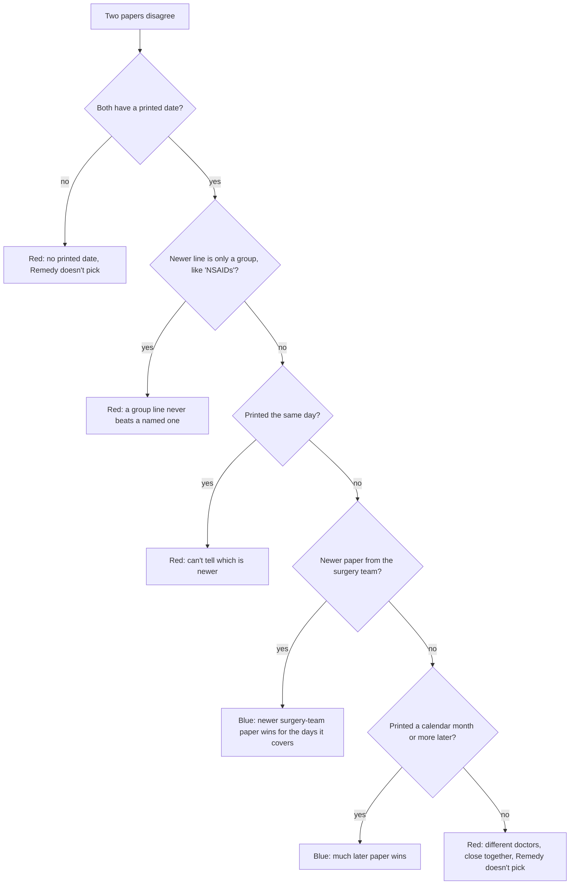
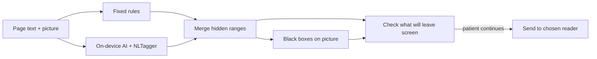
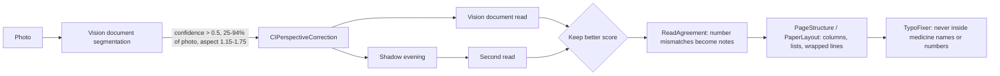

# What's clever inside Remedy

Remedy is an iPhone app (iOS 27, SwiftUI and SwiftData) that turns the papers a patient brings home around surgery into a day-by-day plan: what to take, what to stop, when to stop it, and when to start again.

This page explains the technology behind it. Each section starts with a plain-English summary, then the technical detail for clinicians and engineers. File paths are under `Remedy/` unless they say otherwise. Tests are in `RemedyTests/` and use Swift Testing.

One design rule runs through all of it. **AI reads the papers. AI never makes a medical decision.** Doses, days, and which paper to follow are plain Swift rules in `Remedy/Core`, with no SwiftUI and no SwiftData, and they are covered by tests. AI is used for four jobs only: reading a page into a draft, finding names to hide, picking which line of the papers answers a question, and rewording a red card's two quotes in plainer words.

> Remedy is a planning and reminder aid that shows patients what their own papers say. It is not a medical device and has not been clinically validated. All patient data in this project is fake.

---

## Contents

1. [The paper check](#1-the-paper-check)
2. [Quote-grounded reading](#2-quote-grounded-reading)
3. [Hiding names before anything leaves the phone](#3-hiding-names-before-anything-leaves-the-phone)
4. [Pluggable AI readers with privacy tiers](#4-pluggable-ai-readers-with-privacy-tiers)
5. [Plan days counted from surgery](#5-plan-days-counted-from-surgery)
6. [Dose scheduling](#6-dose-scheduling)
7. [Reading the hospital's "last given" time](#7-reading-the-hospitals-last-given-time)
8. [Matching medicines and showing what changed](#8-matching-medicines-and-showing-what-changed)
9. [Page capture and reading](#9-page-capture-and-reading)
10. [Ask, answered only from the papers](#10-ask-answered-only-from-the-papers)
11. [The demo engine](#11-the-demo-engine)
12. [Two looks, one brain](#12-two-looks-one-brain)
13. [How it is tested](#13-how-it-is-tested)

---

## 1. The paper check

**In plain English.** Patients often get papers from several doctors: the surgeon's office, the hospital at discharge, a cardiologist, a pharmacy. These papers can disagree about the same medicine. Remedy compares every paper's line for every medicine and marks each comparison:

| Color | Meaning |
|---|---|
| Green | The papers agree. |
| Blue | A newer paper replaced an older one under a clear rule, and Remedy says which rule. |
| Red | The papers disagree and Remedy does not pick. The patient is asked to call the office. |
| Note | Something to ask about calmly. Another doctor lists a medicine the surgery team's papers never mention, or a health record lists a medicine no paper names. |

When doctors disagree, Remedy does not decide who is right. The card stays red until the patient records what the office said.

### How it works

Every medicine line on every paper becomes a `CheckItem`. It carries the paper's source (surgery team, another doctor, pharmacy, or health record), its printed date, its action (take or stop), its start and end days, its strength and amount, and its exact quote.

```
for each pair of lines (a, b):
    skip if both are on the same paper          // one paper is one doctor's plan
    skip unless same medicine (brand or generic)
    skip unless their days overlap
    kind = take vs stop?  -> differentAction
           stop days?     -> differentStopDay
           strength/amount? -> differentDose
           else           -> agree (green)
    rule = which paper, if any, wins (below)
```

Only two known values that differ count as a difference. A blank field means "the paper didn't say", never a conflict.

**Who wins.** The precedence rules, in order:



**"For the days it covers."** A surgery-team paper wins only inside its own period. A pre-op paper is the authority up to surgery day. A post-op paper is the authority from surgery day on. Outside that period, the other doctor's line is followed again. This is `Finding.period` and `followedPaperID(onDay:)`. For example, a pre-op paper that says "stop aspirin" does not silently override a cardiologist's aspirin plan for the weeks after surgery.

**Circles.** With three or more papers, A can beat B, B can beat C, and C can beat A for the same days. The check breaks each medicine's timeline at every edge where a line starts, ends, or loses. On any day where every line for that medicine loses to another line, it reports one red "circle" card. No line is followed on those days until the patient picks.

**While a pair is red.** Remedy names no winner. So that reminders don't simply stop, the pair keeps a recorded default line: the surgery team's line if one of the two is theirs, otherwise the newer one. `askByDay` is the day before the papers first say different things, so the card can tell the patient when they need an answer.

**Disagreements that are over.** `Finding.lastDisagreementDay` works out the last plan day the two papers still say different things. Two different stop days only disagree until the later stop begins, because after that both papers say "stop". `isOver(today:)` is true once that day has passed. The paper-check view model then moves the card off Today and out of the red list. It stays in the notes on the papers screen, and its daily "ask by" reminder stops.

**One place where the check meets everything else.** `Persistence/PaperCheckReport.swift` caches one report per plan. It hands doses (`slotsWithCheck`), reminders (`itemsWithCheck`), and Ask (`answerWithCheck`) only the paper line the rules follow on each day. A replaced line produces no doses on the days it was replaced.

### Why it matters for safety

Conflicting instructions are a common source of medication mistakes around surgery, especially for blood thinners. Remedy never hides a disagreement, never resolves one by guessing, and explains every blue decision in words (`NewerPaperRule.explanation`). For example: "Your newer paper is from your surgery team, so it replaces the older lines."

### Where it lives

- `Core/PaperCheck.swift`: pairs, kinds, colors, periods, circles, notes, gaps, `lastDisagreementDay`, `isOver`
- `Core/NewerPaperRule.swift`: rule 6 (surgery team, or a month apart; no printed date never wins)
- `Core/MedicineIdentity.swift`: same medicine under brand, generic, or group names
- `Persistence/PaperCheckInput.swift`, `Persistence/PaperCheckReport.swift`
- `Interface/ViewModels/Papers/PaperCheckViewModel.swift`: red cards vs notes, `isOver` filtering
- `Services/AI/CheckExplainer.swift`: optional plainer wording of a red card's two quotes; it never sets the color

### Tests

- `PaperRuleTests.swift`, suite `NewerPaperRuleTests`: `newerSurgeryTeamPaperWinsEvenOneDayLater`, `anotherGiverWinsOnlyAMonthOrMoreLater`, `missingOrSamePrintedDateNeverPicks`, `explanationNamesWhoAndHowLongAfter`
- `PaperRuleTests.swift`, suite `PaperCheckTests`: `samePlanOnTwoPapersAgrees`, `differentDoctorsCloseTogetherIsRedAndNotPicked`, `newerSurgeryTeamPaperIsBlueAndFollowed`, `surgeryTeamOlderAndOtherNewerIsRedWithSurgeryTeamAsDefault`, `monthLaterFromAnyoneIsBlue`, `missingPrintedDateIsRed`, `savedNotePicksThePaper`, `recordMedicineNoPaperNamesIsAGap`, `otherDoctorsMedicineTheSurgeryTeamSkipsIsANote`, `twoLinesOnOnePaperAreNotCompared`, `dayRangeIntersectionAndOutside`
- `DemoHistoryTests.swift`: `aPastDisagreementLeavesTodayButStaysOnThePapers` (the Eliquis red card is shown before surgery, is gone from Today by day 4, stays in the notes, and its reminder stops), `papersShowEachPaperCheckColor`
- `PlanBehaviorTests.swift`: `conflictingPapersShowARedCard`, `onePaperHasNothingToCompare`

---

## 2. Quote-grounded reading

**In plain English.** Every item in the plan keeps the paper's exact words. Before an AI-read item is accepted, Remedy checks that those words are really on the page. If they aren't, the item is set aside and shown to the patient as "left out", along with the reason. The patient then confirms each item next to its quote. Only confirmed items are saved.

### How it works

```
for each item the AI returned:
    if its quote is not on the page text           -> leftOut("not on the page")
    if its day number isn't written on the page    -> leftOut / no day
    if a phone number's digits aren't on the page  -> dropped
    else                                           -> draft item, with its quote and page number
```

- `SourceMatcher` keeps three forms of the page text: original, normalized (case and accents folded, punctuation turned into spaces), and compact (no spaces, so "81mg" matches "81 mg").
- A quote counts as found if the whole quote is on the page, or if every piece of a quote the model joined from several lines is on the page (`AIPlanConverter.isOnPage`).
- `SourceCheck.isDayStated` accepts a day only if that number is written on the page, as a digit or a word ("4" or "four"). It also accepts weeks: day 14 is accepted when "2" weeks is written.
- Items that fail go to `draft.leftOut` as a `LeftOutItem` with what the AI said and why it was dropped. The patient can see them.

### Why it matters for safety

A language model can produce a plausible medicine or day that the paper never states. Quote checking turns "the AI said so" into "the paper says so, here are its words". This makes it hard for a hallucinated item to reach the plan without the patient seeing it. Each saved item keeps `quote`, `paper`, and `paperID`, so every reminder can be traced back to its source line.

### Where it lives

`Core/SourceCheck.swift`, `Services/AI/AIPlanConverter.swift`, `Core/LeftOutItem.swift`, `Interface/ViewModels/Scan/ScanFlowViewModel+Confirm.swift`, `Persistence/PlanImporter.swift`

### Tests

- `PlanStoreTests.swift`: `onlyConfirmedItemsAreSaved`
- `DemoHistoryTests.swift`: `bundledPapersMatchTheirAnswersAfterTheBlackout` (every quote in the sample answers is found in its page text after redaction)
- `PlanBehaviorTests.swift`: `askAnswersFromThePapersNeverInventing`
- `SourceMatcher`, `SourceCheck`, and `AIPlanConverter` have no dedicated unit tests yet. They are covered through these flow tests.

---

## 3. Hiding names before anything leaves the phone

**In plain English.** Before a page can go to any AI that runs off the phone, Remedy blacks out the patient's name, record numbers, date of birth, address, phone, and email, in both the text and the picture. The patient then sees the hidden version of each page and can tap any word to hide or show every copy of it. Nothing is sent until they continue.

### How it works

Three layers, each adding to the others ("hide if either flags it"):

1. **Fixed rules** (`Core/Redactor.swift`)
   - Labeled values: `Patient name:`, `MRN`, `DOB`, `CSN`, `FIN`, `Acct`, insurance, guarantor, emergency contact, and others. Values under name labels are also hidden everywhere else on the page.
   - Header names: an unlabeled name in front of MRN or DOB on a header line.
   - Patterns: emails, the patient's own cell or home phone, street addresses, apartment numbers, city/state/ZIP, "born on …", "Mr/Mrs …", "Dear …", and numbers of 6 or more digits that aren't phone numbers.
   - Names the patient typed in (`Core/PatientNames.swift`, stored in the Keychain), matched even when the camera misread them.
   - A known medicine word on a medicine line is kept, so "Warfarin" isn't hidden just because it looks like a surname.
2. **On-device AI pass** (`Services/AI/AIRedactor.swift`). Apple's on-device model (or Private Cloud Compute, if the patient picked it) and `NLTagger` look for names and details. A second look at the top and bottom of each page catches what the first pass missed. The model sorts names into patient vs staff, so a doctor's name isn't hidden by mistake.
3. **The picture** (`Services/Reading/PageBlackout.swift`). Black boxes are drawn over the same words using Vision's word boxes. Only the part of a line holding the hidden word is covered, so a medicine next to a name stays readable. Barcodes are covered too, because patient stickers often carry the record number.

`RedactedPage` keeps the original text plus sorted, merged hidden ranges. That is what makes "tap to show or hide every copy" exact.



### Why it matters for safety and privacy

If a patient chooses a cloud reader, it receives the content of the papers but not the patient's identity. Showing the patient the hidden page (the `checkHidden` step) is the final safeguard, because no automated redactor is perfect. When only the fixed rules ran, the page is marked `usedAI = false` and the screen says it "can miss a name, so check the page".

### Where it lives

`Core/Redactor.swift`, `Core/PatientNames.swift`, `Services/AI/AIRedactor.swift`, `Services/Reading/PageBlackout.swift`, `Interface/ViewModels/Scan/ScanFlowTypes.swift` (`checkHidden`)

### Tests

`ImportAndPrivacyTests.swift`: `typedNamesAreHiddenEverywhere`, `idNumbersOnTheHeaderAreHidden`, `tappingShowsAndHidesEveryCopy`, `patientNameWordsAreSplit`. `DemoHistoryTests.swift`: `bundledPapersMatchTheirAnswersAfterTheBlackout` checks that the fake patient's surname never reaches the saved page text.

---

## 4. Pluggable AI readers with privacy tiers

**In plain English.** The patient picks who reads their papers, from most private to least:

| Tier | Examples | Where the page goes |
|---|---|---|
| On this iPhone | Apple's on-device model, downloaded models (MLX) | Nowhere |
| Apple Private Cloud Compute | Apple's private servers | Apple's servers, which Apple designs so it can't see or keep the page |
| Your own Mac | A model on the home network | Your Mac |
| Cloud | Claude, Gemini, OpenAI-compatible services | That provider, after redaction, with the patient's own key |

If the chosen reader fails or isn't ready, Remedy shows a plain error and offers to try another reader. **It never switches to a cloud reader on its own.**

### How it works

- One protocol, `PlanReader`, with `readPlan(from:pictures:paper:)`. Only the redacted text and the blacked-out JPEGs are passed in.
- `PlanReaders.reader(for:)` is the one place a choice becomes a reader. Adding a provider means one adapter file, one `ModelChoice` entry, and one case there.
- `ModelPlanReader` works with any FoundationModels `LanguageModel`: `SystemLanguageModel`, `PrivateCloudComputeLanguageModel`, MLX models, Claude through `ClaudeForFoundationModels`, and OpenAI-compatible servers through `foundation-models-utilities`. The model answers in the `AIPlan` shape using guided generation (Gemini uses a JSON schema over REST).
- API keys are read from the Keychain (`Services/Security/KeychainStore.swift`). None are in the code.
- On failure, the scan flow sets `showsTryOnPhone` and says "… could not read the page. You can try again or use another reader." Switching is always the patient's choice.
- Reading the page picture can also be done by a second reader. Any number the camera and the model read differently is shown to the patient (`Core/ReadAgreement.swift`, see section 9).

**Deterministic demos.** `ExpectedAnswerReader` is an answer key for the bundled sample papers. It returns the exact expected draft for a known sample page and **throws `notASamplePaper` for anything else**. It never guesses and never calls an AI. This makes judge and investor demos repeatable and offline. `FakePlanReader` (debug `-demoFakeAI`) returns fixed sample drafts.

### Why it matters

Privacy is a choice the patient makes knowingly, not a default that quietly changes. A silent fallback from "on my phone" to "in the cloud" would break that promise, so the code has no path that does it.

### Where it lives

`Services/AI/PlanReader.swift`, `ModelPlanReader.swift`, `ModelChoice.swift`, `ClaudeAdapter.swift`, `OpenAICompatibleAdapter.swift`, `Gemini/`, `Local/LocalModels.swift`, `Local/MacConnector.swift`, `AIPrompt.swift`, `PromptExamples.swift`, `Interface/ViewModels/Scan/ScanFlowViewModel+AIChoice.swift`

### Tests

`DemoHistoryTests.swift`: `expectedAnswersReadEachSamplePaperAndNothingElse` (each sample paper gets its own answer, and an unknown paper throws).

---

## 5. Plan days counted from surgery

**In plain English.** Remedy stores every date as "days from surgery". Day 0 is surgery day, day -7 is a week before, day +3 is three days after. If the surgery is rescheduled, the patient changes one date and the whole plan moves with it.

### How it works

`DayMath` converts plan days to real dates and back using calendar start-of-day, so time of day and daylight-saving changes don't shift a day. Items store `startDay`, `endDay`, and `dueDay` as offsets. Dose times are minutes after midnight (`timesOfDay`). `PlanActions.setSurgeryDate` changes only `CarePlan.surgeryDate`.

```
date(forDay: d, minute: m) = startOfDay(surgery) + d days + m minutes
dayOffset(of: date)        = whole calendar days from startOfDay(surgery) to startOfDay(date)
```

### Why it matters

Pre-op instructions are usually written relative to surgery ("stop 5 days before"). Storing them that way keeps them correct when the date moves, which is a common real-world event.

**Where:** `Core/DayMath.swift`. **Tests:** `WordsAndDatesTests.swift` (`planDaysRoundTrip`, `dayOffsetIgnoresTimeOfDay`), `ActionTests.swift` (`surgeryDateMoveKeepsPlanDays`).

---

## 6. Dose scheduling

**In plain English.** For each day, Remedy lists every dose with its state: upcoming, due, taken, skipped, or missed. For "as needed" medicines it shows how many were taken today, when the next one is allowed, and whether the daily maximum is reached. The first dose at home starts from when the hospital last gave it. If a dose is missed, Remedy asks "Did you take it?" and never tells the patient to take an extra one to catch up.

### How it works

**Slots.** `DoseSchedule.slots(onDay:plan:now:skipped:)` returns one `DoseSlot` per paper time for each medicine that is confirmed, has action `take`, is active that day, and isn't replaced by the paper check that day. Slots are sorted by time and keep paper order when times are equal.

**States** (`state(at:log:now:)`):

```
logged taken           -> taken
logged skipped         -> skipped
now > time + 60 min    -> missed
now >= time - 30 min   -> due
otherwise              -> upcoming
```

**First home dose** (`firstHomeDose`, `doseTimes`):

```
first = lastGivenAt + minHoursBetween
keep paper times >= first + minHoursBetween
insert `first` if it falls on this day
if the hospital dose was on this day and maxPerDay is set:
    keep at most maxPerDay - 1 home doses   // hospital dose counts toward the day
```

For twice-daily medicines with fixed times, the hospital's dose fills the matching slot instead (`hospitalDose`). That slot shows as taken (`givenInHospital`) and is never reminded.

**As needed** (`asNeededStatus`). Counts today's taken logs, with the hospital's last dose counted like a logged one. `nextAllowed = last + minHoursBetween` if that time is still in the future. `reachedMax = takenToday >= maxPerDay`. `canTakeNow` requires both limits to be clear.

**Missed doses.** The Today screen asks "Did you take the 2 PM acetaminophen?" and offers "Yes, I Took It" (logged at the due time) or "No, I Missed It" (logged as skipped). The advice is "Don't take an extra one to catch up. Your next one is at …". There is no "take it now" path. A second answer for the same dose replaces the first, and every log returns an undo token.

### Why it matters for safety

Taking a pain medicine too soon after the hospital's last dose, going over a daily maximum (for example with acetaminophen), or doubling up after a missed dose are all real risks. Each guard is a small, readable rule with a test.

### Where it lives

`Core/DoseSchedule.swift`, `Persistence/DoseActions.swift`, `Persistence/DoseSchedule+Models.swift`, `Interface/ViewModels/Today/TodayScreen.swift` (`missedAdvice`, `answerMissed`), `Core/ReminderPlan.swift` (at most 60 notifications, under iOS's limit of 64)

### Tests

- `ActionTests.swift`: `doseStatesFollowTheClock`, `firstHomeDoseStartsFromTheHospitalDose`, `asNeededWaitsTheGapAndStopsAtTheMost`, `secondAnswerChangesTheSameDose`, `takenDoseUndoesBackToNothing`, `changedDoseIsMarkedAsThePatients`
- `DemoHistoryTests.swift`: `simpleMedicinesNeverSayTakeAMissedDoseNow`
- `PlanBehaviorTests.swift`: `remindersAreNeverInThePastAndNeverRepeat` (every demo patient), `plansLongOverHaveNoDoseReminders`

---

## 7. Reading the hospital's "last given" time

**In plain English.** Discharge papers often list when each medicine was last given in the hospital. Remedy reads that time so the first dose at home waits the right gap. The parser is strict on purpose. If the time is unclear, it returns nothing, and if it's missing AM or PM, the patient picks.

### How it works

`LastGivenParser.reading(from:pageText:printedDate:medicineNames:)` returns one of three results:

- `.none`: no printed date, the words aren't actually on the page, no clock time, or two different clock times.
- `.time(date)`: exactly one clear time, such as "1:40 PM", "1:40pm", "1:40 p.m.", or a 24-hour time like "13:40" or "08:15", placed on the paper's printed day (the discharge day).
- `.needsAmPm(am:, pm:)`: a time like "1:40" that could be morning or afternoon. Remedy tries to settle it from two independent clues: lines that name the medicine, and which half of the day comes before the print time. It decides only when both clues agree. Otherwise the patient chooses, and only one of the two offered times is accepted.

### Why it matters

A wrong "last given" time would shift the first home dose. Returning nothing is safe, because the plan then simply keeps the paper's normal times.

**Where:** `Core/LastGivenParser.swift`, used by `DoseSchedule.firstHomeDose`. **Tests:** covered indirectly by `ActionTests.firstHomeDoseStartsFromTheHospitalDose`. The parser has no dedicated unit test yet.

---

## 8. Matching medicines and showing what changed

**In plain English.** "Tylenol" and "acetaminophen" are the same medicine, and "NSAIDs" includes ibuprofen. Remedy knows this when it compares papers and answers questions. When a new paper is added later, Remedy shows what it changed: new medicines, changed ones, restarted ones, ones still stopped, and ones the new discharge paper no longer mentions.

### How it works

- **`MedicineIdentity`**: names are normalized (lowercase, no punctuation, strength removed) and expanded through a brand table, for example `["apixaban", "eliquis"]` and `["ibuprofen", "advil", "motrin"]`. Two lines are the same medicine when their name sets overlap. Matching is by exact names only, with no fuzzy guessing. Group lines ("NSAIDs", "blood thinners", "vitamins and supplements") expand only to members the patient actually has. A group line never beats a named line.
- **`MedicineMatcher`**: finds which plan medicines a sentence or question names. The longest name wins, and a name contained in a longer match is dropped. It then gives a verdict (`dontTake`, `stopSoon`, `okToTake`, `asNeeded`, `startsLater`, `finished`, and so on) for today.
- **`WhatChanged`**: compares the new paper's lines with the newest earlier line for the same medicine:

```
no earlier line            -> new
stop -> take               -> restarted
stop -> stop, days differ  -> changed   (else stillStopped)
take -> stop               -> changed
take -> take, differ       -> changed
old lines a replacing discharge paper omits -> notMentioned
```

"Something not mentioned is never restarted on its own."

**Where:** `Core/MedicineIdentity.swift`, `Core/MedicalWords.swift`, `Core/MedicineMatcher.swift`, `Core/MedicineNameCleaner.swift`, `Core/WhatChanged.swift`. **Tests:** `WordsAndDatesTests.swift` (`sameMedicineUnderBrandOrGenericName`, `medicineNamesAreCleaned`), `ActionTests.swift` (`renamedMedicineDropsOldBrandNames`), `PlanStoreTests.swift` (`secondPaperJoinsTheSamePlan`). The What Changed screens are drawn in both looks in `ScreenTests.swift`.

---

## 9. Page capture and reading

**In plain English.** Patients photograph papers on kitchen tables, in bad light. Remedy finds the page, squares it up, evens out shadows, and reads the text on the phone. If the page was hard to read, it reads it a second time and keeps the better result. Any number the two readings disagree on, such as "5" vs "50", is shown to the patient instead of being trusted silently.

### How it works



- **Edge finding and squaring** (`PagePreparer.flattened`). The detected shape is rejected if it's too small (probably a sticker), fills almost the whole photo (already flat), or isn't shaped like a sheet of paper.
- **Shadow evening** (`PagePreparer.evenLight`). The text is removed with a morphological max filter and a blur to estimate the light falling on the paper. The page is then divided by that estimate and the contrast is raised. The image stays the same size, so word boxes still line up for redaction.
- **Two reads.** The second read is kept only if it scores more than 3% better. Lines whose numbers differ between the two reads become patient-facing notes (at most three). Smudged dates or doses, like a stray mark between digits, are flagged and never "fixed" by guessing.
- **Layout rebuilding** (`Core/PageStructure.swift`, `Core/PaperLayout.swift`) puts columns, list items, and wrapped lines back together from word positions and line tilt.
- PDFs that already contain text are read directly (`PDFReader.swift`).

**Where:** `Services/Reading/PagePreparer.swift`, `TextReader.swift`, `TypoFixer.swift`, `PDFReader.swift`, `PageBlackout.swift`, `Core/ReadAgreement.swift`, `Core/PageStructure.swift`, `Core/PaperLayout.swift`. **Tests:** camera and Vision code needs a device and has no unit tests. The bundled sample papers and their answers are checked in `DemoHistoryTests.swift` and `ImportAndPrivacyTests.swift` (`samplePapersAreReadableHTML`).

---

## 10. Ask, answered only from the papers

**In plain English.** The patient can ask questions like "Can I take Advil?" Answers come only from their papers and show the paper's own words. Worrying symptoms always lead to "call your surgeon" or "call 911". If the papers don't say, Remedy says so and tells the patient who to call.

### How it works

1. **Word rules first** (`Core/AskAnswers.swift`), in a fixed order. Danger words always win, even if a medicine is named. Then: a named medicine (showing every paper that mentions it and answering from the line the paper check follows), an instruction topic, visits, what to take today, and finally "not on your papers, call the office". If two medicines are named, Remedy asks which one. An open circle of papers gives no answer.
2. **Only if the rules find nothing**, the on-device model picks which numbered fact from the papers answers the question (`AskPicker`). The answer shown is that fact's exact line. If the model thinks the question describes a symptom, the answer becomes "call your surgeon". Ask never sends the question to a cloud AI.
3. Suggested questions are built from the plan, so each one has an answer.

**Where:** `Core/AskAnswers.swift`, `Core/AskFacts.swift`, `Services/AI/Ask/SmartAsk.swift`, `Services/AI/Ask/AskPicker.swift`, `Interface/ViewModels/Ask/AskViewModel.swift`. **Tests:** `PlanBehaviorTests.swift` (`askAnswersFromThePapersNeverInventing`, `askSuggestionsNameRealMedicines` for every demo patient, `surgeonPhoneIsTheCareTeams`).

---

## 11. The demo engine

**In plain English.** Remedy includes 15 fake patients for demos and testing. Each one is dated from today, so "day 4 at home" is always day 4, whenever the demo runs. Past days are filled in to look like real use: doses taken a few minutes late, one skipped, one missed today, pain pills, evening check-ins, and finished to-dos. A pretend clock lets a presenter jump to any day or time.

### How it works

- **Rebasing** (`DemoScenarios.rebased`). Moves each sample paper's surgery date to "today + N days". Printed dates and visits keep their gap to surgery. Papers with no date get sensible defaults (the before paper printed 5 days ahead, the after paper on the day). Because plan items are surgery-relative (section 5), everything else follows automatically.
- **History** (`DemoHistory.fill`). Fills at most the last 7 days. It uses the real `DoseSchedule.slots` and `PaperCheckReport`, so the fake history follows the same rules as a real plan. Lateness is chosen in turn from a fixed list, so the result is deterministic. Running it again adds nothing. It runs only on sample data, never on a real plan.
- **Pretend clock** (`AppClock.now()`). The only source of "now" in the app. In demo mode it adds a whole-day shift and an optional fixed start time that then ticks forward. Changing it posts `.demoClockChanged` and every screen redraws.
- **Safe swap** (`DemoMode`). Moves the real plan aside while a demo runs and puts it back afterward.

**Where:** `Core/AppClock.swift`, `App/LaunchOptions.swift`, `Persistence/Demo/DemoScenarios.swift`, `DemoHistory.swift`, `DemoPatient.swift`, `SamplePlan.swift`, `Interface/ViewModels/Settings/DemoModeViewModel.swift`. **Tests:** `DemoHistoryTests.swift` (`pastDaysAreFilledAndTodayHasOneMissedDose`, `fillingTwiceAddsNothing`, `aVisitOnSeveralPapersIsOneVisit`), `PlanStoreTests.swift` (every demo plan loads), `ScreenTests.swift` (every main screen for all 15 patients).

---

## 12. Two looks, one brain

**In plain English.** Remedy has two looks. **Classic** uses tabs and lists. **Simple** has big buttons, one thing per screen, and plain words. On the Automatic setting, Remedy switches to Simple when the iPhone's text size is set to one of the extra-large accessibility sizes.

### How it works

- Every screen has one view model in `Interface/ViewModels`, shared by both looks. All wording lives there. Views in `Screens/ClassicUI` and `Screens/SimpleUI` only draw, so a rule or a word changes in one place.
- `AppLookMode.look(largeText:)` returns `.simple` for `.automatic` when `dynamicTypeSize.isAccessibilitySize` is true (`App/RootView.swift`).

### Why it matters

Many surgery patients are older, tired, or on pain medication. Sharing the view models means the Simple look can't drift from the Classic look on a safety rule. For example, both say "Don't take an extra one".

**Where:** `App/AppLook.swift`, `App/RootView.swift`, `Interface/ViewModels/Simple/`. **Tests:** `ScreenTests.swift` draws every main screen in both looks for all 15 demo patients, at morning, afternoon, and night. `SpeedTests.swift` times Today and Home. The automatic switch itself has no dedicated test.

---

## 13. How it is tested

- **Swift Testing**, with in-memory SwiftData. The rules in `Core` can run on plain structs or on real models, because Core is generic over protocols (`Core/PlanFacts.swift`).
- **Coverage by area**

| Test file | Area |
|---|---|
| `PaperRuleTests.swift` | Paper check colors, rule 6, notes, gaps |
| `ActionTests.swift` | Dose states, first home dose, as-needed limits, undo, moving surgery |
| `ImportAndPrivacyTests.swift` | Redaction, patient names, FHIR mapping, record merge |
| `PlanBehaviorTests.swift` | Red cards, reminders never in the past, Ask never invents |
| `DemoHistoryTests.swift` | Demo history, past disagreements, expected-answer reader, quotes after blackout |
| `PlanStoreTests.swift` | Saving, joining papers, backup round trip, every demo plan |
| `ScreenTests.swift` | Every main screen in both looks, all 15 demo patients |
| `WordsAndDatesTests.swift` | Day math, dates, phones, fasting times, medicine names |

- **Project rule:** a test is never weakened or deleted to make it pass.
- **Known gaps:** `LastGivenParser`, `SourceMatcher`/`SourceCheck`, `WhatChanged`, `ReadAgreement`, `AppClock`, demo rebasing, and the automatic look switch are covered only indirectly, through flow and screen tests. They are good candidates for dedicated unit tests.

---

*Remedy is an aid for following your own papers. It does not replace your care team. When papers disagree or something feels wrong, call your surgeon's office, or 911 in an emergency.*
