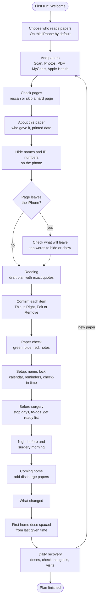

# How Remedy works

Remedy is an iPhone app (iOS 27, SwiftUI and SwiftData) that turns a patient's surgery papers into a plan for each day: what to stop before surgery, what to take after it, what to do, and who to call.

This page describes the processes behind the app, for three readers:

- **Website visitors** who want to know what using Remedy is like.
- **Hospital partners** such as HSS, who want to know how the app treats their papers and their patients.
- **Contributors** who want to know how the app is built and checked.

Every example on this page uses the fake demo patient **Ruth Callahan** (right total knee replacement, Thursday, November 12, 2026) and fake 555-01xx phone numbers. No real patient data is used anywhere in Remedy's demos, tests or screenshots.

Contents:

1. [The patient journey](#1-the-patient-journey)
2. [When papers disagree](#2-when-papers-disagree)
3. [Care team and family](#3-care-team-and-family)
4. [Running a demo](#4-running-a-demo)
5. [How we build safely](#5-how-we-build-safely)

---

## 1. The patient journey

The papers flow through one guided sequence in the app (`Interface/ViewModels/Scan/ScanFlowViewModel.swift`):

`welcome → addPapers → pages → (importPick) → paperDetails → reading → checkHidden → confirm → finish → (whatChanged) → (setup)`

After that, the plan drives the Today, Medicines, Plan and Help screens from surgery prep through recovery.



### 1.1 First run and choosing who reads the papers

The welcome screen offers **Get Started**, **Try Demo Mode** and **Restore Backup**, with the line "Remedy helps you read your papers. It doesn't replace your doctor."

Reading happens in three steps, and the patient picks who does each one (`ReaderSetupViewModel.swift`, `Services/AI/ModelChoice.swift`):

| Step | What it does | Choices |
|---|---|---|
| Reading the page | Turns the photo into words | iPhone camera reading (Apple Vision plus Remedy's own layout rules), a downloaded reading model, or Apple Private Cloud Compute |
| Hiding your name | Blacks out the name and record numbers | Apple's on-device model, a downloaded model, Private Cloud Compute, or built-in rules only |
| Making your plan | Finds medicines, instructions and visits | On this iPhone (the default), a downloaded model, Apple Private Cloud Compute, a model on the patient's own Mac, or a cloud AI (Claude, Gemini, OpenAI, OpenRouter, Groq, Mistral or a custom server) with the patient's own key |

Each choice is labeled by where the page goes: *Stays on this iPhone*, *Stays on your home network*, *Apple Private Cloud* or *Online*. API keys are stored in the Keychain. The choice can be changed at any time from the papers screen ("Change how papers are read") or in Settings.

If the chosen reader is not ready or fails, the app says so in plain words and lets the patient pick again. **It never switches to a cloud reader by itself.**

### 1.2 Adding papers

"Where are your papers?" offers:

- **Scan With Camera.** VisionKit's document camera. Remedy finds the page edges, squares the page and evens out shadows (`Services/Reading/PagePreparer.swift`).
- **Choose Photos.** Pictures from the library.
- **Choose a PDF.** PDFs with text are read directly. Scanned PDFs are read like photos.
- **Import From MyChart (Epic).** SMART on FHIR sign-in. Brings in the surgery date, visits, the medicine list and up to 10 recent visit notes. The patient ticks which items to keep. Picked notes go through the same hiding and checking as scanned pages. The papers always win over the record: the record only fills empty fields and adds items the papers don't name.
- **Import From Apple Health.** Medicine list from Health Records, on iPhones that support them.

For scans, photos and PDFs the patient says whether the papers are from before or after surgery, or picks "Not sure, let Remedy sort it". Fixed rules sort the papers from what the page says, never the AI, and the patient can change what they decided.

Before anything is read, the patient sees the pages and can scan one again. A page with no readable words gets its own screen to rescan or skip. A skipped page becomes a to-do so it is never forgotten.

**About this paper.** The patient confirms who gave the paper (Surgeon's office, Hospital when you went home, Another doctor, or Pharmacy) and the printed date. These two facts feed the paper check later.

### 1.3 Name blackout and "check what will leave"

Before the reader that makes the plan sees a page, Remedy removes personal details on the phone. (Only on-device steps, such as reading the words and suggesting who gave the paper, see the page before this.)

- The name the patient typed (kept in the Keychain), names that Apple's on-device model or `NLTagger` finds, and header lines with MRN, date of birth, account and similar numbers (`Core/Redactor.swift`, `Services/AI/AIRedactor.swift`).
- The same words are covered with black boxes on the page picture (`Services/Reading/PageBlackout.swift`).

When the page will leave the iPhone, the **checkHidden** step shows the hidden version and where it is going, for example "Going to Apple Private Cloud" or "Going to Claude". The patient can tap any word to hide or show every copy of it. Nothing is sent until the patient continues. If the AI could not check every page, the screen says so and asks the patient to look closely.

### 1.4 Reading

The reading screen shows a checklist of real stages: reading words, removing personal info, the model reading, finding instructions.

- The reader answers in a fixed shape (`AIPlan`), which is converted into a draft plan (`Services/AI/AIPlanConverter.swift`).
- **Every item must quote the page.** An item whose quote is not on the page, or whose day the page doesn't state, is left out with the reason (`Core/SourceCheck.swift`). The patient can see what was left out.
- When a page model and the camera read the same page, any number they read differently (5 mg vs 50 mg, a smudged date) is shown to the patient, never fixed by guessing (`Core/ReadAgreement.swift`).
- Things a plan usually has but this read did not find, such as the surgeon's phone number, are listed so the patient can add them (`Core/ReadGaps.swift`).

### 1.5 Confirming each item

The **confirm** step shows one card at a time ("Item 1 of 8"): a plain-words summary next to the paper's exact quote and where it came from. For each item the patient taps **This Is Right**, edits it, or removes it. Only confirmed items are saved.

Medicine cards may ask a follow-up when the paper is unclear. For example, if the hospital's "last given" time has no AM or PM, the patient picks one. The app never guesses either way.

### 1.6 The paper check

As soon as more than one paper names the same medicine, Remedy compares them (`Core/PaperCheck.swift`). Brand and generic names are matched as one medicine, for example Eliquis and apixaban. The result is a set of colored cards, described in [section 2](#2-when-papers-disagree).

### 1.7 Setup

Before the first plan is saved, a short setup asks one thing per screen: first name (optional, used only to hide it from papers), app lock with Face ID or passcode, adding visits to a Remedy calendar, dose reminders, and the daily check-in time. Every step has **Not now**, is asked only once, and can be changed in Settings. If the surgery date is not clear, the app asks for it, so a visit date on the papers never becomes the surgery date by accident.

### 1.8 The daily plan before surgery

Days are counted from surgery: day 0 is surgery day and negative days are before it (`Core/DayMath.swift`). Moving the surgery date moves the whole plan.

- **Stop days.** Each stop is worked out from the paper's words ("7 days prior", "48 hours prior", "the evening prior"). For Ruth, the papers stop aspirin and supplements 7 days before and ibuprofen, naproxen and meloxicam 4 days before.
- **Last-dose question (optional).** On a stop day Today can ask "Any Advil today?". If the patient says yes, it explains "Your paper says not to" and offers **Call Surgeon's Office**.
- **To-dos** from the papers with due days, such as "have your cardiologist fax your clearance", "bring inhalers" or "pick up your rolling walker".
- **Plan** shows the next visit (call, directions, add to calendar), rules like *No driving*, and a timeline of stop, restart and surgery days.
- **Get ready list.** Arrival, stop eating and drinking, what to bring, and how each stop went ("Stopped on time", "Took some after the stop date", "No answer").

### 1.9 The night before and surgery morning

- **The night before.** From 5 PM, Today shows a heads-up card about tomorrow: a medicine that stops tomorrow, an early visit, and the arrival time and hospital (`Core/TonightHeadsUp.swift`).
- **Surgery morning.** Today's card says "Arrive by 6:00 AM" and the food and drink cut-off worked out from the papers and the arrival time. For Ruth, "nothing to eat after midnight" and "clear liquids until 2 hours before arrival" become a 4:00 AM clear-liquids cut-off (`Core/FastingTimes.swift`, `Core/SurgeryMorningWords.swift`). Remedy never makes up a "leave by" time because it doesn't know the travel time.
- Morning-of medicines appear as doses, for example metoprolol and levothyroxine with a sip of water.

### 1.10 Coming home

The patient adds the discharge papers with the same flow. Discharge papers usually split medicines into START, CHANGE, CONTINUE and STOP.

- **What changed.** After a new paper joins the plan, a screen lists what is new, changed, restarted, or no longer mentioned (`Core/WhatChanged.swift`). A discharge paper replaces older papers from the same team.
- **First home dose from the last given time.** Discharge papers often say "Last time this was given: … at 11:40 AM". Remedy reads that time strictly (`Core/LastGivenParser.swift`) and spaces the first dose at home from it using the paper's interval. Paper times that fall too soon after the hospital dose are skipped, and the hospital dose counts toward the daily maximum (`Core/DoseSchedule.swift`). For Ruth, Tylenol was last given at 6:02 AM, so the next dose is due at 2:00 PM.
- **Restarts.** A stopped medicine comes back on the restart day the paper gives, for example Eliquis "Start taking on: November 14". If a paper says to wait for the doctor, the medicine stays stopped until the patient records who said it's OK (surgeon's office, another doctor or pharmacist) and when.

### 1.11 Daily recovery

- **Today** shows the dose due now with **I Took It** and **Not Now**, the rest of the day, visits today and to-dos. Taking a dose can be undone.
- **Missed doses.** A missed dose is shown as a question with clear advice, for example "Did you take the 9 AM apixaban? Don't take an extra one to catch up." Remedy never tells a patient to take a missed dose now.
- **As-needed medicines** show "You can take 1 now" or the time of the next allowed dose, based on the gap on the paper and the daily maximum. At the maximum they stop. For Ruth, oxycodone is every 4 hours, at most 6 tablets a day.
- **Check-in.** Pain from 0 to 10, a short note, and an optional photo of the incision that stays on the phone and is never analyzed. **Pain of 8 or more shows a call button** for the surgeon's office. A reminder comes at the time the patient picked.
- **Goals** such as walking, PT exercises and ice, with a "2 of 3" count for the day.
- **Visits** with call, directions and add to calendar. For Ruth, home PT on November 16 at 11 AM.
- **Ask** answers questions from the papers only, and every answer shows the paper's exact words. "Can I shower?" gets the shower rule from the discharge paper. A question the papers cannot answer gets "call your surgeon's office" with the number, never a guess.
- **Something looks wrong** on any medicine lets the patient fix the item or send a short report with personal details hidden.
- **Reminders, widgets, Live Activity and Siri** show the next dose, and notification buttons can log a dose without opening the app.

### 1.12 Adding later papers

New papers can be added at any time, from the same flow. Each new paper:

1. Goes through the same blackout, reading and confirmation.
2. Joins the existing plan instead of replacing it.
3. Shows **What changed**.
4. Runs the paper check again against every earlier paper.

### 1.13 Finishing

When every medicine, rule and goal from the papers has ended, Today shows **"Your plan is done"**. Medicines that are still stopped with no restart day are listed separately, because they wait for the doctor.

---

## 2. When papers disagree

Patients often get papers from several doctors on different days. Remedy compares every pair of papers that name the same medicine. It looks at whether to take or stop it, then the stop day, then the dose. Plain, tested rules decide the color. AI is never involved.

| Card | Meaning | Ruth's example |
|---|---|---|
| **Green** | The papers agree. | Metoprolol the morning of surgery: the internist and the cardiologist agree. |
| **Blue** | A newer paper replaced an older one under a clear rule. | After surgery, the discharge paper's November 14 Eliquis restart is followed over the cardiologist's "24 hours after surgery". |
| **Red** | The papers disagree and no rule decides. Remedy does not pick. | Eliquis before surgery: the cardiologist says hold 2 days, the internist and the surgeon say stop 3 days. |
| **Note** | Only another doctor's paper names a medicine the surgery team's papers don't. | A calm note suggests asking the surgeon's office. |

### 2.1 When a newer paper wins on its own

A newer paper wins automatically only in these cases (`Core/PaperCheck.swift`, `Core/NewerPaperRule.swift`):

- It comes from the **surgery team** (the surgeon's office or the hospital at discharge), and only for the days it covers. A pre-op paper covers the days up to surgery, and a discharge paper covers the days from surgery on.
- It comes from the same team as the older paper.
- It was printed **a month or more** after the older paper.

A finding is **red** when:

- the papers come from different doctors and none of the cases above applies, or
- either paper has no printed date (so no paper can be called newer), or
- the newer line is a generic group ("Any other NSAID") and the older names the medicine. A group line never beats a named one.

When three or more papers beat each other in a circle, no paper is followed until the patient picks one.

### 2.2 What the patient sees on a red card

- A plain question: "When to stop Eliquis?", "Take or stop …?" or "How much … to take?"
- **Both quotes**, with who wrote each paper and when it was printed.
- An ask-by day: "Ask by Friday." or "Ask today." The ask-by day is the day before the papers start to say different things. From that day, a 9 AM reminder repeats until the question is settled (`Core/AskByReminder.swift`).
- **A call button** for each doctor whose office number is on the papers, or the care team number.
- What Remedy does meanwhile, in plain words, for example "Until you hear back, Remedy follows Dr. Okafor's paper." A fixed rule picks that paper: the surgery team's paper when the other is from another doctor, otherwise the newer one. For a circle, or a paper with no date, the card says "Remedy isn't following any of these papers until you choose."

Red cards are shown on Today while their days are still ahead. When all the days in question are past, the card moves to the notes on the Papers screen. **It is never deleted or hidden.**

### 2.3 Calling the office and saving the answer

1. The patient taps **Call** on the card and asks the office which paper is right.
2. In **Sort it out**, the patient picks the paper the office said to follow, and can type what the office said and who said it.
3. Remedy saves this as a check note (`PaperCheckNote`). From then on, doses, reminders and Ask follow the chosen paper on the days in question. The card becomes a note, "Sorted out", that keeps both quotes and the office's answer.

For a note about a medicine only another doctor mentioned, the patient can mark it as asked in the same way.

An optional AI may reword a red card's two quotes in plainer language. It only explains. The card, its color and the paper that is followed always come from the rules.

---

## 3. Care team and family

Remedy keeps everything on the patient's iPhone, and the database is not synced. Family members are helped through printouts, shared contacts and the patient's own phone.

### 3.1 Sharing with family

**Share** makes a PDF a family member can print or receive:

| Sheet | What's in it |
|---|---|
| Medicines overview | Medicines, what not to do yet, visits and phone numbers |
| Day | Every dose that day with a box to tick, what happens and who to call |
| Medicines | Every medicine and what to do with it on that day |
| Journey | Every key day from start to finish, with dates |
| Everything | Medicines, visits, instructions, phone numbers, the ready list and anything to ask the office |
| Plan | Medicines, rules, visits and to-dos, with check-ins and the dose log if switched on |

The patient's name is printed only if they turn on "Print my name at the top". **Emergency Info** writes a short Medical ID text and can make a Wallet card.

### 3.2 Help

**Help** is never more than one tap away (a Help button on every Classic tab and on the Simple home screen). It shows:

- **Call 911** for trouble breathing, chest pain, fainting or heavy bleeding.
- **Your care team.** Numbers from the papers, care team first, then the pharmacy, then family contacts the patient adds. Each contact has Call and Message. For Ruth: Dr. Whitfield's office 555-0142, after hours 555-0143, HSS Home Care 555-0150, pharmacy 555-0165, cardiology 555-0131.

### 3.3 When to call

**When should I call?** lists the warning signs from the patient's own papers, each with the number from the same paper line (`Core/WarningSigns.swift`). For Ruth, the cardiology letter says a racing heart means call the office, and chest pain or passing out means call 911. Common warning signs after surgery are shown too, labeled as general.

Other prompts to call come from the rules, never from AI:

- a red paper check card,
- a pain check-in of 8 or more,
- a stopped medicine the patient says they took,
- a question Ask cannot answer from the papers.

---

## 4. Running a demo

Demo mode works in every build and is off until someone turns it on. The patient's real plan is copied to a safe place on the phone first and comes back when demo mode ends.

### 4.1 Show the HSS knee replacement demo

1. Open **Settings → Demo mode** and turn it on.
2. Under **Start here**, tap **HSS knee replacement** ("4 papers, day 4 at home, past days filled in"). This loads Ruth Callahan's four papers on their printed dates (surgery Thursday, Nov 12) and moves the pretend clock to day 4. The days since coming home are already filled in: doses taken a few minutes late, last night's Senokot skipped, check-ins for days 1 to 3 (pain 7, then 6, then 5).
3. **Pretend today is.** Move the fake today by whole days, pick a date, **Jump to surgery day**, or go **Back to real today**. Move back before surgery to see the red Eliquis card on Today.
4. **Sample Papers** opens each of the four PDFs inside the app, with a Share button to save them to Files:

   | Paper | From | Printed |
   |---|---|---|
   | D1 internist pre-op | Primary care, Dr. Elena Brooks | Oct 22 |
   | D2 cardiology letter | Heart specialist, Dr. Samuel Okafor | Oct 30 |
   | D3 surgeon pre-op | Surgery team, Dr. Daniel Whitfield | Nov 2 |
   | D4 discharge | Surgery team, Dr. Daniel Whitfield | Nov 13 |

5. **Live upload.** With demo mode on, add D1 to D4 from Files through the normal Add papers flow. The past days fill in as soon as the papers are saved. Uploading at 2 PM shows the 6 AM Tylenol taken at about 6:03, not a list of missed doses.
6. **Read papers with** sets how added papers are read:
   - **Your AI:** the AI picked in Settings, for example Claude, really reads the papers. Compare its result with `SamplePapers/demo/EXPECTED.md`.
   - **Expected answers:** no AI. The sample papers get their answer key every time. Any other paper shows an error instead of a guess.
7. **Exit demo mode.** The real plan, doses, chat and photos come back, and anything added in demo mode is removed. The fake plan never goes into the real calendar.

On day 4 at 2:00 PM, the expected screens are listed in `SamplePapers/demo/EXPECTED.md`. In short: Tylenol due now, a missed 9 AM apixaban, oxycodone "You can take 1 now", home PT at 11 AM, and the red, blue and green cards on the Papers screen.

Other demo patients are grouped as *Start here*, *Which papers*, *When the surgery is* and *Tricky plans*, for example "Surgery tomorrow", "Papers disagree" and "As-needed medicines".

### 4.2 Launch options for screenshots

Debug builds read these launch arguments (`App/LaunchOptions.swift`). Set them in the Xcode scheme or pass them to `xcrun simctl launch`.

| Argument | Effect |
|---|---|
| `-demoScenario hssKnee` | Starts with Ruth's demo plan in memory (papers on their printed dates, clock moved to day 4) |
| `-demoTime 14:00` | Fixes the clock at that time of day (HH:MM); it then runs forward from launch |
| `-appLookMode classic\|simple\|automatic` | Picks the look the app draws |
| `-appLook classic\|simple` | The look that shared sheets and pickers style themselves with; pass it with `-appLookMode` so both match |
| `-skipPermissionPrompts YES` | Hides the lock, calendar and reminder setup steps so screenshots are not blocked |

Example (Simple look, day 4 at 2 PM):

```bash
xcrun simctl launch booted com.dorronhoffman.Remedy \
  -demoScenario hssKnee -demoTime 14:00 \
  -appLookMode simple -appLook simple -skipPermissionPrompts YES
```

**Picking the day.** The HSS papers keep their printed dates (surgery Thursday, November 12, 2026), and the app moves its pretend clock to the day you ask for. Set the day after surgery in the app's defaults, because launch arguments that start with a minus sign aren't read as numbers:

```bash
xcrun simctl spawn booted defaults write com.dorronhoffman.Remedy demoPlanDay -int -5
```

`-5` is 5 days before surgery (Saturday, Nov 7) with the red Eliquis card on Today, `0` is surgery day, `4` is day 4 at home (Monday, Nov 16, the default), and `14` is two weeks out. Demo mode turns itself on so the clock can move. Leave demo mode in Settings to go back to the real date.

Website screenshots for the HSS demo (before, surgery day and after, both looks) are in `docs/app-media/hss-demo/`, with a guide in [GALLERY.md](GALLERY.md).

---

## 5. How we build safely

### 5.1 Project rules

These rules come from `CLAUDE.md` and apply to every change:

- **Medical decisions are plain, tested rules in `Core`, never AI judgment.** Dose times, as-needed limits, stop and restart days, fasting times, the paper check, Ask answers, warning signs and reminders are all plain Swift in `Remedy/Core`, with no SwiftUI or SwiftData. AI is used only to read pages into a draft, find names to hide, pick which paper line answers a question, and reword a red card's quotes. It never decides a dose, a day, or which paper wins.
- **Never hide a disagreement between papers.** A red card stays visible until the patient settles it, and moves to the notes only when all its days are past.
- **Never silently fall back to a cloud AI.** A failed reader shows an error and a way to pick another. The patient sees the hidden page before anything leaves the phone.
- **Fake data only.** Demo and test data use made-up patients, 555-01xx phone numbers and "SAMPLE" on every paper.
- **No API keys in code.** Keys, saved patient names and the MyChart token go in the Keychain.
- **Both looks for every screen.** View models in `Interface/ViewModels` hold all logic and wording, and are shared by the Classic look (`Screens/ClassicUI`) and the Simple look (`Screens/SimpleUI`: big buttons, one thing per screen, plain words). Views only draw. *Automatic* picks Simple at accessibility text sizes.
- **Saved plans must keep opening.** New SwiftData stored properties must be optional or have a default.
- **Every item keeps its source.** Each medicine, rule, to-do and visit stores the paper's exact quote and which paper it came from.
- **No commit without the maintainer's approval.**

UI rules (contrast, 44 pt tap targets, Dynamic Type up to AX5, VoiceOver labels, Reduce Motion, plain words at about a 6th-grade level) are in `docs/ui-rules.md`.

### 5.2 Tests

Tests use **Swift Testing** with in-memory SwiftData, in `RemedyTests/`. Tests are never weakened or deleted to make them pass.

| File | Covers |
|---|---|
| `PaperRuleTests.swift` | Paper check colors, the newer-paper rule, notes, gaps |
| `WordsAndDatesTests.swift` | Day math, wording, phone and date parsing, fasting times, medicine names |
| `ImportAndPrivacyTests.swift` | MyChart (FHIR) mapping, import picks, record merge, redaction, patient names |
| `PlanStoreTests.swift` | Saving, joining papers, backup round trip, every demo plan |
| `ActionTests.swift` | Dose log and undo, as-needed limits, edits, contacts, to-dos, check-ins, moving surgery |
| `PlanBehaviorTests.swift` | Red cards, reminders never in the past, Ask quotes are real, suggestions name real medicines |
| `DemoHistoryTests.swift` | The HSS demo: each paper check color, filled past days, sample quotes after blackout, expected answers |
| `ScreenTests.swift` | Every main screen drawn in both looks for every demo patient, view models at morning, afternoon and night, every share PDF |
| `SpeedTests.swift` | Performance of the heavy rules |

Contributors build and test with `scripts/check.sh build` and `scripts/check.sh test [TestStruct]`, which print only errors and failures. `xcodebuild` is used directly when a closer look is needed.

### 5.3 Sample papers and expected answers

Demo papers are written to prove the app works on realistic papers, not papers made easy for it. `SamplePapers/demo/PAPER-GUIDE.md` sets the rules:

- Copy the format and voice of real printouts (Epic After Visit Summary, discharge summaries, clinic letters), including their noise: vitals, lab orders, long generic medication lists.
- **Never add a line just to help the app.**
- Fake names, an 8-digit fake MRN, 555-0100 to 555-0199 phone numbers, `example.org` links, and **SAMPLE - NOT A REAL PATIENT** in red at the top and bottom of every page.
- Build in the cases the app must handle: one red disagreement, one blue newer surgery team paper, a duplicate medicine on a list, as-needed limits, a last given time, restart dates, warning signs, visits, to-dos and goals.

How a paper set is made and checked:

1. Each paper is written in a small markup in `SamplePapers/demo/papers/*.md`.
2. `swift SamplePapers/demo/make-demo-pdfs.swift` renders them into After Visit Summary style PDFs in `SamplePapers/demo/pdfs/`, which are bundled with the app.
3. The expected answers are written by hand in `SamplePapers/demo/EXPECTED.md` and in code as `Remedy/Persistence/Demo/RuthDrafts.swift`.
4. Tests verify them:
   - **Every quote is checked word for word** against the bundled PDF text after the name blackout. The test also confirms the patient's name never reaches the saved page text.
   - The expected-answer reader returns each paper's own answer and throws an error for any other paper.
   - Loading the papers produces the red, blue and green findings and the day 4 Today screen described in `EXPECTED.md`.

### 5.4 Review and release

The repository shows this process:

1. **Phased plan.** Work is split into phases (`.claude/build/phase-N.md`), each step naming the files it touches. Progress is logged in `.claude/build/progress.md`, and handoff notes in `.claude/handoff/` let paused work resume cleanly.
2. **Matched helpers.** Each step goes to the right builder (`.claude/agents/`): small mechanical edits, normal feature steps, or a dedicated "engine" step for safety-critical logic such as the paper check, the last-given parser, data upgrades and backup.
3. **Full test run** at the end of each phase.
4. **Read-only review** against `CLAUDE.md`. The reviewer looks for logic in views, screens missing a Simple version, medical safety problems (silent overrides, silent cloud fallback, reminders for replaced items, hidden disagreements), model changes that break saved data, real-looking data or secrets, and unused code. Must-fix items are fixed before the phase closes.
5. **Simulator QA pass** of each feature in both looks, with screenshots (`.claude/build/qa-report.md`). Items that need a real device, like the Live Activity, are marked open.
6. **Guard rails in settings.** The project's `.claude/settings.json` blocks `git commit`, `git push`, `git reset`, `git checkout` and `rm` for automated helpers. Commits and releases (for example "V 2.1") are made by the maintainer after review.
